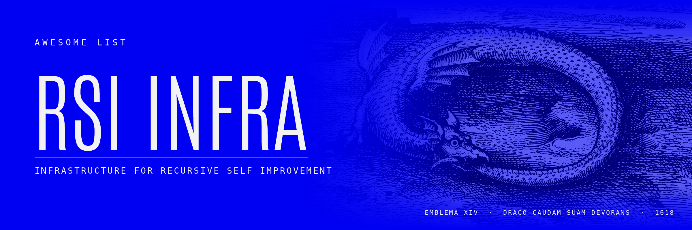
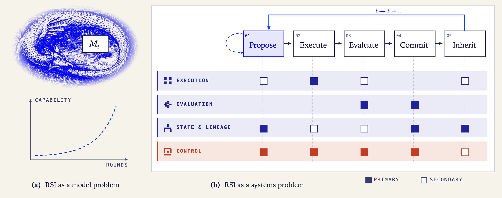
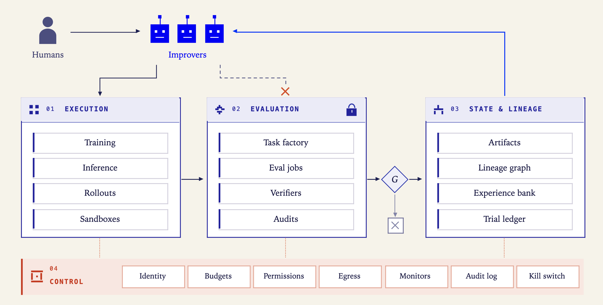
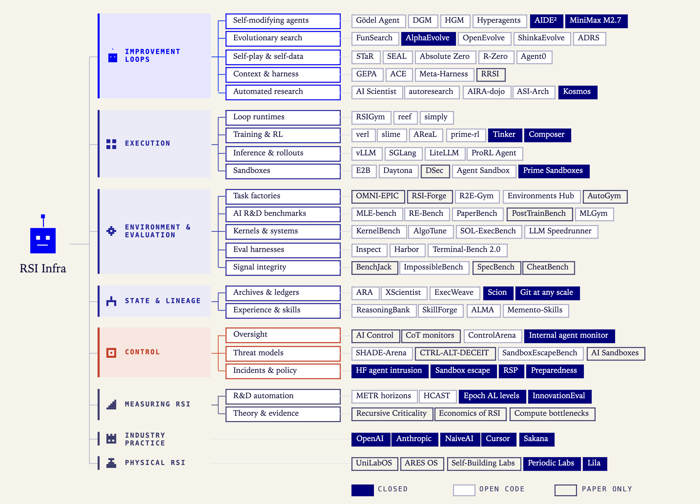
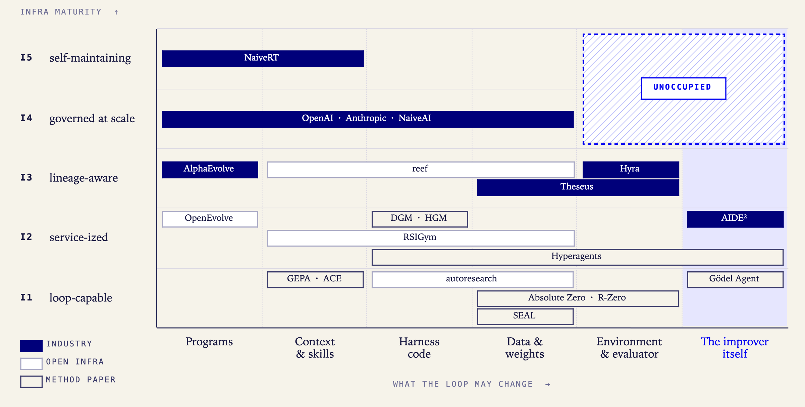
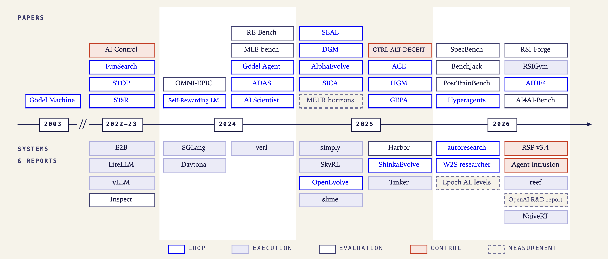

<p align="center">
  
</p>

<p align="center">
  <i>The papers, the open systems and the closed ones.</i>
</p>

<p align="center">
  Yuxiao Lee, Yuping Zhou, Zherui Yang, Fan Liu, Siqi Lai, Zirui Yuan, Yansong Ning, Hao Liu
  <br>
  <sub>The Hong Kong University of Science and Technology (Guangzhou)</sub>
</p>

<p align="center">
  <a href="#the-list"></a>
  <a href="#definition--scope"></a>
  <a href="CONTRIBUTING.md"></a>
  <a href="#survey--citation"></a>
  <a href="https://awesome.re"></a>
  <a href="LICENSE"></a>
</p>

<p align="center">
  
</p>

> **RSI is not a model problem. It is a systems problem.**
> The bottleneck is moving from *proposing* a better change to *executing, verifying, keeping and containing* it.
> This list collects the infrastructure that makes that possible, whether it shipped as a paper, a repo, a blog post, a product or an incident report.

---

## Contents

- [Definition & Scope](#definition--scope)
- [Taxonomy](#taxonomy)
- [Landscape](#landscape)
- [Timeline](#timeline)
- [The List](#the-list)
  <!-- BEGIN TOC -->
  - [I. Surveys & Perspectives](#surveys)
  - [II. Improvement Loops](#loops)
  - [III. Execution Plane](#execution)
  - [IV. Environment & Evaluation Plane](#evaluation)
  - [V. State & Lineage Plane](#state)
  - [VI. Control Plane](#control)
  - [VII. Measuring RSI](#measurement)
  - [VIII. Industry Practice](#industry)
  - [IX. Physical RSI Infra](#physical)
  <!-- END TOC -->
- [Related Resources](#related-resources)
- [Contribute](#contribute)
- [Survey & Citation](#survey--citation)
- [Star History](#star-history)

---

## Definition & Scope

**RSI infrastructure** is the set of system services that lets an improvement loop run *repeatedly, at scale and under explicit authority*: it executes proposed changes, produces signals the improver cannot unilaterally alter, records and passes accepted changes on to later rounds, and enforces budgets, permissions and oversight across all of them.

One round of the loop acts on a system state $S_t = (M_t, h_t, D_t, E_t, I_t)$, i.e. weights, harness, data, environment/evaluator and the improver itself:

**Propose** a change $\Delta_t$ → **Execute** it under budget $B$ and permissions $P$ → **Evaluate** it with a verifier $V$ the improver cannot write → **Commit** or roll back through a gate $G$ → **Inherit** $(\text{parent}, \Delta_t, \text{evidence}, V\text{-version}, G\text{-decision})$ into the lineage.

The loop is *recursive* once $I$ is itself among the things $\Delta$ may change, and is judged by the quality of the improvements it goes on to make.

<p align="center">
  
</p>

| Plane | The question it answers | Typical components |
|---|---|---|
| `01` **Execution** | How do changes run cheaply, in parallel, isolated and reproducibly? | sandbox fleets, training / inference / rollout services, async jobs |
| `02` **Environment & Evaluation** | Where does the signal come from, and how is it kept honest? | task factories, verifiers, held-out sets, judges, audits |
| `03` **State & Lineage** | How are accepted changes kept, attributed, inherited and rolled back? | artifact registries, lineage graphs, experience banks, trial ledgers |
| `04` **Control** | Who may change what, at what cost, and who is watching? | identity, budgets, permissions, egress gateways, monitors, kill switches |

**What goes in.** This list leans toward the point where papers meet engineering.

*In scope*

- papers that ship code, systems, environments or benchmarks (preferred)
- open-source systems with **no paper** that improvement loops actually run on
- **closed** systems described in public: lab blogs, technical reports, incident write-ups, policies, disclosed metrics
- methods, under *Improvement Loops*, when they show what the loop needs from its infrastructure

*Out of scope*

- general agent frameworks or LLM tooling with no link to an improvement loop

For a method-centric map of RSI, see the related lists [below](#related-resources).

---

## Taxonomy

<p align="center">
  
</p>

* **RSI Infra**
    * [**Improvement Loops**](#loops) (the workloads)
        * self-modifying agents · evolutionary program search · self-generated data & self-play · context, skill & harness evolution · automated research systems
    * [**Execution Plane**](#execution)
        * loop runtimes & research platforms · training & RL post-training · inference & rollout serving · sandboxes
    * [**Environment & Evaluation Plane**](#evaluation)
        * task & environment factories · AI R&D benchmarks · kernel & systems optimisation tasks · evaluation harnesses · signal integrity & reward hacking
    * [**State & Lineage Plane**](#state)
        * archives, lineage & trial ledgers · experience, skills & memory
    * [**Control Plane**](#control)
        * oversight & monitoring · sabotage, sandboxes & threat models · incidents & policies
    * [**Measuring RSI**](#measurement)
        * measuring AI R&D automation · theory & economics
    * [**Industry Practice**](#industry) · [**Physical RSI Infra**](#physical)

---

## Landscape

<p align="center">
  
</p>

The horizontal axis is what a loop is allowed to change; the vertical axis is how mature the infrastructure under it is. Placements are our reading of each paper, repo or report. The top-right corner, deep recursion on governed infrastructure, is still empty.

| Level | Name | What it means | Examples |
|---|---|---|---|
| **I1** | Loop-capable | One agent in one sandbox can propose, execute and evaluate | autoresearch, early DGM |
| **I2** | Service-ized | Training, inference, eval and sandboxes are services with async jobs and explicit budgets | RSIGym, reef |
| **I3** | Lineage-aware | Changes are versioned with evidence, can be rolled back and inherited; the evaluator is protected | HGM, AlphaEvolve |
| **I4** | Governed at scale | Fleet-level identity, monitor coverage, egress control, audit and public metrics | OpenAI, Anthropic, NaiveAI |
| **I5** | Self-maintaining | The infrastructure itself is improved by the loop, under protected invariants | NaiveRT (an early signal) |

These levels are orthogonal to *who* does the work (Epoch's AL0–AL5), *how autonomous* the improver is (L1–L5) and *whether* the loop is recursive (R1/R2): they describe what the improver runs on.

---

## Timeline

<p align="center">
  
</p>

---

## The List

`OPEN` code or system released&emsp;`CLOSED` described in a blog, report or paper, not released&emsp;`PAPER` paper only

<!-- BEGIN LIST -->
<a id="surveys"></a>

### I. Surveys & Perspectives

> Surveys, position papers and scenario pieces that frame RSI as a whole.

<details open>
<summary><b>Entries</b> <sub>(9)</sub></summary>

| Year | Title | Venue / Org | Links | Access | Why it matters for infra |
|---:|---|---|---|:-:|---|
| 2025 | **A Survey of Self-Evolving Agents**: What, When, How, and Where to Evolve on the Path to Artificial Super Intelligence | TMLR | [paper](https://arxiv.org/abs/2507.21046) | `PAPER` | Organises self-evolving agents by what evolves, when, and how. |
| 2025 | A Comprehensive Survey of Self-Evolving AI Agents: A New Paradigm Bridging Foundation Models and Lifelong Agentic Systems | arXiv | [paper](https://arxiv.org/abs/2508.07407) · [code](https://github.com/ANative-Lab/Awesome-Self-Evolving-Agents) | `OPEN` | Feedback-loop framework (inputs, agent system, environment, optimisers) for self-evolving agents. |
| 2025 | The Landscape of Agentic Reinforcement Learning for LLMs: A Survey | TMLR | [paper](https://arxiv.org/abs/2509.02547) · [code](https://github.com/HHHHHejia/Awesome-AgenticLLM-RL-Papers) | `OPEN` | Survey formalizing agentic RL as POMDPs; compiles environments, frameworks and benchmarks. |
| 2026 | **Recursive Self-Improvement in AI**: From Bounded Self-Refinement to Autonomous Research Loops | arXiv | [paper](https://arxiv.org/abs/2607.07663) · [code](https://github.com/deepgrounding/recursive-self-improvement) | `OPEN` | Sorts 1,250 papers by improvement target and by how closed the loop is. |
| 2026 | **Self-Improvements in Modern Agentic Systems**: A Survey | arXiv | [paper](https://arxiv.org/abs/2607.13104) · [code](https://github.com/selfimproving-agent/Awesome-Self-Improving-Agents) | `OPEN` | Splits self-improvement into foundation-model updates and scaffold updates. |
| 2026 | **Safety in Self-Evolving Agents**: A Survey | arXiv | [paper](https://arxiv.org/abs/2610.00093) | `PAPER` | Risks that arise when agents update parameters, memories, tools, skills and workflows after deployment. |
| 2026 | **The Last AI Built by Humans**: Toward Genuine Recursive Self-Improvement | arXiv | [paper](https://arxiv.org/abs/2609.11873) | `PAPER` | L1–L5 autonomy levels plus industrial case studies; names cross-round inheritance infra as an open challenge. |
| 2026 | **From Existing Methods to New Research Ideas**: Two Perspectives on Recursive Self-Improvement | arXiv | [paper](https://arxiv.org/abs/2610.14625) · [project](https://prism-shadow.github.io/awesome-rsi/) | `PAPER` | Nine-dimension design space of RSI methods; the method-side complement to this list. |
| 2026 | Toward Recursive Self-Improvement in Physical AI | arXiv | [paper](https://arxiv.org/abs/2610.29677) · [code](https://github.com/Physical2RSI/Awesome-Physical2RSI) | `OPEN` | R1/R2 criteria for when a robot-learning loop is genuinely recursive. |

</details>

<a id="loops"></a>

### II. Improvement Loops

> The workloads. Self-modifying agents, evolutionary search, self-play and automated-research systems. They are here because what each loop needs from its infrastructure is visible in how it is built.

<details open>
<summary><b>II.1&ensp;Self-modifying agents</b> <sub>(16)</sub></summary>

| Year | Title | Venue / Org | Links | Access | Why it matters for infra |
|---:|---|---|---|:-:|---|
| 2003 | **Goedel Machines**: Self-Referential Universal Problem Solvers Making Provably Optimal Self-Improvements | arXiv<br><sub>IDSIA</sub> | [paper](https://arxiv.org/abs/cs/0309048) | `PAPER` | The original self-rewriting problem solver; accepts a rewrite only with a proof of utility. |
| 2023 | **Self-Taught Optimizer (STOP)**: Recursively Self-Improving Code Generation | COLM 2024 | [paper](https://arxiv.org/abs/2310.02304) · [code](https://github.com/microsoft/stop) | `OPEN` | A scaffold that improves code, then improves itself; logs sandbox-escape attempts along the way. |
| 2024 | Automated Design of Agentic Systems | ICLR 2025 | [paper](https://arxiv.org/abs/2408.08435) · [code](https://github.com/ShengranHu/ADAS) | `OPEN` | A meta agent writes new agents in code and keeps an archive of evaluated designs. |
| 2024 | **Gödel Agent**: A Self-Referential Agent Framework for Recursive Self-Improvement | ACL 2025 | [paper](https://arxiv.org/abs/2410.04444) · [code](https://github.com/Arvid-pku/Godel_Agent) | `OPEN` | Agent patches its own runtime logic, including the code that does the patching. |
| 2025 | A Self-Improving Coding Agent | arXiv | [paper](https://arxiv.org/abs/2504.15228) · [code](https://github.com/MaximeRobeyns/self_improving_coding_agent) | `OPEN` | A coding agent that edits its own codebase, with an async overseer watching each run. |
| 2025 | **Darwin Godel Machine**: Open-Ended Evolution of Self-Improving Agents | arXiv<br><sub>Sakana AI · UBC</sub> | [paper](https://arxiv.org/abs/2505.22954) · [code](https://github.com/jennyzzt/dgm) · [blog](https://sakana.ai/dgm/) | `OPEN` | Archive of self-modified coding agents; every child runs in a sandbox and is scored on SWE-bench. |
| 2025 | **Huxley-Gödel Machine**: Human-Level Coding Agent Development by an Approximation of the Optimal Self-Improving Machine | arXiv | [paper](https://arxiv.org/abs/2510.21614) · [code](https://github.com/metauto-ai/HGM) | `OPEN` | Scores a node by the success of its descendants (clade metaproductivity), not its own benchmark score. |
| 2025 | **Live-SWE-agent**: Can Software Engineering Agents Self-Evolve on the Fly? | arXiv | [paper](https://arxiv.org/abs/2511.13646) · [code](https://github.com/OpenAutoCoder/live-swe-agent) · [project](https://live-swe-agent.github.io) | `OPEN` | Starts from a bash-only scaffold and evolves its own scaffold during runtime. |
| 2026 | **Group-Evolving Agents**: Open-Ended Self-Improvement via Experience Sharing | arXiv | [paper](https://arxiv.org/abs/2602.04837) | `PAPER` | Makes a group of agents the unit of evolution so experience is shared across lineages. |
| 2026 | Hyperagents | arXiv<br><sub>Meta</sub> | [paper](https://arxiv.org/abs/2603.19461) · [code](https://github.com/facebookresearch/HyperAgents) | `OPEN` | DGM-H; the meta-level improvement procedure is itself editable, for any computable task. |
| 2026 | **MiniMax M2.7**: Early Echoes of Self-Evolution | Blog<br><sub>MiniMax</sub> | [blog](https://www.minimax.io/news/minimax-m27-en) | `CLOSED` | Model ran 100+ rounds of analyze-failures, edit scaffold, evaluate, keep-or-revert on itself. |
| 2026 | **The Red Queen Gödel Machine**: Co-Evolving Agents and Their Evaluators | arXiv | [paper](https://arxiv.org/abs/2606.26294) | `PAPER` | Co-evolves agents and learned evaluators under controlled, non-stationary utilities. |
| 2026 | **Mendel Gödel Machine**: Recursive Self-Improving Coding Agents via Comparative Evolution | arXiv | [paper](https://arxiv.org/abs/2608.07645) · [code](https://github.com/RealLcz/MGM) · [project](https://reallcz.github.io/MGM) | `OPEN` | Derives self-modifications by comparing many archived attempts instead of one failure trace. |
| 2026 | Recursive self-improvement of AI research agents | arXiv<br><sub>Weco AI</sub> | [paper](https://arxiv.org/abs/2609.26457) · [blog](https://www.weco.ai/blog/first-evidence-of-recursive-self-improvement) | `CLOSED` | A research agent rewrites its own code; each accepted rewrite becomes the next round's editor. |
| 2026 | **MetaShare**: Failure-Aware Collective Self-Improvement for Open-Ended Agents | NeurIPS 2026 Workshop | [paper](https://arxiv.org/abs/2610.21887) | `PAPER` | Keeps failed improvement attempts as reusable cross-branch knowledge to avoid search collapse. |
| 2026 | **RSIFlow**: Adaptive Self-Improvement Workflows with an Evolving Meta-Agent | arXiv | [paper](https://arxiv.org/abs/2610.21791) | `PAPER` | Diagnoses the current bottleneck, picks a component-specific improvement workflow, and evolves its own harness. |

</details>

<details open>
<summary><b>II.2&ensp;Evolutionary program search</b> <sub>(14)</sub></summary>

| Year | Title | Venue / Org | Links | Access | Why it matters for infra |
|---:|---|---|---|:-:|---|
| 2023 | Mathematical discoveries from program search with large language models | Nature<br><sub>Google DeepMind</sub> | [paper](https://www.nature.com/articles/s41586-023-06924-6) · [code](https://github.com/google-deepmind/funsearch) | `OPEN` | LLM proposer + automatic evaluator + programs database, run asynchronously at scale. |
| 2025 | **AlphaEvolve**: A coding agent for scientific and algorithmic discovery | arXiv<br><sub>Google DeepMind</sub> | [paper](https://arxiv.org/abs/2506.13131) · [blog](https://deepmind.google/blog/alphaevolve-a-gemini-powered-coding-agent-for-designing-advanced-algorithms/) | `CLOSED` | Evolves whole codebases against machine-checkable evaluators; also used on Google's own training and scheduling stack. |
| 2025 | **OpenEvolve**: open-source implementation of AlphaEvolve | GitHub | [code](https://github.com/algorithmicsuperintelligence/openevolve) | `OPEN` | Program database, island model and async evaluator pool; a common base for re-implementations. |
| 2025 | **ShinkaEvolve**: Towards Open-Ended And Sample-Efficient Program Evolution | arXiv<br><sub>Sakana AI</sub> | [paper](https://arxiv.org/abs/2509.19349) · [code](https://github.com/SakanaAI/ShinkaEvolve) | `OPEN` | Novelty rejection sampling and bandit model selection to spend fewer evaluations per discovery. |
| 2025 | **Barbarians at the Gate**: How AI is Upending Systems Research | arXiv | [paper](https://arxiv.org/abs/2510.06189) · [code](https://github.com/UCB-ADRS/ADRS) | `OPEN` | AI-driven systems research where simulators provide reliable verifiers for evolved algorithms. |
| 2025 | **CodeEvolve**: an open source evolutionary coding agent for algorithmic discovery and optimization | EMNLP 2026 Findings | [paper](https://arxiv.org/abs/2510.14150) · [code](https://github.com/inter-co/science-codeevolve) | `OPEN` | Island-based search over a CVT-MAP-Elites archive with a weighted LLM ensemble. |
| 2025 | **GigaEvo**: An Open Source Optimization Framework Powered By LLMs And Evolution Algorithms | arXiv | [paper](https://arxiv.org/abs/2511.17592) · [code](https://github.com/FusionBrainLab/gigaevo-core) | `OPEN` | Fills in the implementation details AlphaEvolve-style papers leave out, for reproducibility. |
| 2025 | **ThetaEvolve**: Test-time Learning on Open Problems | arXiv | [paper](https://arxiv.org/abs/2511.23473) · [code](https://github.com/ypwang61/ThetaEvolve) | `OPEN` | Couples evolutionary search with RL so the model internalises what the search finds. |
| 2026 | Learning to Discover at Test Time | arXiv | [paper](https://arxiv.org/abs/2601.16175) · [code](https://github.com/test-time-training/discover) | `OPEN` | Test-time RL on a single problem to discover new state-of-the-art solutions. |
| 2026 | Simple Baselines are Competitive with Code Evolution | ICLR 2026 Workshop (RSI) | [paper](https://arxiv.org/abs/2602.16805) · [code](https://github.com/YonatanGideoni/code_evo_simple_baselines) | `OPEN` | Two simple baselines match complex code-evolution pipelines across several domains. |
| 2026 | Effective Harness Engineering for Algorithm Discovery with Coding Agents | arXiv | [paper](https://arxiv.org/abs/2605.15221) | `PAPER` | Shows the execution harness, not just the model, decides discovery success at fixed token budget. |
| 2026 | AlphaEvolve is available for everyone | Product<br><sub>Google Cloud / Google DeepMind</sub> | [blog](https://cloud.google.com/blog/products/ai-machine-learning/alphaevolve-is-available-for-everyone) | `CLOSED` | Gemini-based code optimization and discovery agent made generally available as a cloud service. |
| 2026 | **Dream-RSI**: Recursive Self-Improvement through Evolving Worlds | arXiv | [paper](https://arxiv.org/abs/2609.14858) | `PAPER` | Replays past discovery trees as a cheap simulator to refine the exploration policy before redeploying it. |
| 2026 | **FrugalEvo**: Towards Cost-Aware LLM-Guided Program Evolution | arXiv | [paper](https://arxiv.org/abs/2610.03675) · [code](https://github.com/chchenhui/frugalevo) | `OPEN` | Cost-aware program evolution: strong LLM plans strategies, cheap LLM implements; maximizes gain per cost. |

</details>

<details open>
<summary><b>II.3&ensp;Self-generated data & self-play</b> <sub>(8)</sub></summary>

| Year | Title | Venue / Org | Links | Access | Why it matters for infra |
|---:|---|---|---|:-:|---|
| 2022 | **STaR**: Bootstrapping Reasoning With Reasoning | NeurIPS 2022 | [paper](https://arxiv.org/abs/2203.14465) · [code](https://github.com/ezelikman/STaR) | `OPEN` | Generate rationales, keep the ones that reach the right answer, fine-tune, repeat. |
| 2024 | Self-Rewarding Language Models | ICML 2024<br><sub>Meta</sub> | [paper](https://arxiv.org/abs/2401.10020) | `PAPER` | The model judges its own outputs; the judge and the policy improve together over DPO rounds. |
| 2025 | **Absolute Zero**: Reinforced Self-play Reasoning with Zero Data | arXiv | [paper](https://arxiv.org/abs/2505.03335) · [code](https://github.com/LeapLabTHU/Absolute-Zero-Reasoner) | `OPEN` | Proposes its own tasks and verifies them by executing code, with no human data. |
| 2025 | Self-Adapting Language Models | NeurIPS 2025 | [paper](https://arxiv.org/abs/2506.10943) · [code](https://github.com/Continual-Intelligence/SEAL) | `OPEN` | Model writes its own fine-tuning data and update directives, rewarded by downstream gains. |
| 2025 | **R-Zero**: Self-Evolving Reasoning LLM from Zero Data | ICLR 2026 | [paper](https://arxiv.org/abs/2508.05004) · [code](https://github.com/Chengsong-Huang/R-Zero) | `OPEN` | Challenger and solver co-evolve from one base model. |
| 2025 | Language Self-Play For Data-Free Training | arXiv | [paper](https://arxiv.org/abs/2509.07414) | `PAPER` | A single model plays challenger and solver to keep training without new data. |
| 2025 | **Agent0**: Unleashing Self-Evolving Agents from Zero Data via Tool-Integrated Reasoning | COLM 2026 | [paper](https://arxiv.org/abs/2511.16043) · [code](https://github.com/aiming-lab/Agent0) | `OPEN` | Curriculum and executor agents co-evolve; tool use makes the generated tasks verifiable. |
| 2025 | Toward Training Superintelligent Software Agents through Self-Play SWE-RL | ICML 2026 | [paper](https://arxiv.org/abs/2512.18552) | `PAPER` | Single agent self-plays bug injection and repair in sandboxed repos, no human issues. |

</details>

<details open>
<summary><b>II.4&ensp;Context, skill & harness evolution</b> <sub>(6)</sub></summary>

| Year | Title | Venue / Org | Links | Access | Why it matters for infra |
|---:|---|---|---|:-:|---|
| 2025 | **GEPA**: Reflective Prompt Evolution Can Outperform Reinforcement Learning | ICLR 2026 (Oral) | [paper](https://arxiv.org/abs/2507.19457) · [code](https://github.com/gepa-ai/gepa) | `OPEN` | Reflects on traces and keeps a Pareto front of prompts; far fewer rollouts than RL. |
| 2025 | **Agentic Context Engineering**: Evolving Contexts for Self-Improving Language Models | ICLR 2026 | [paper](https://arxiv.org/abs/2510.04618) · [code](https://github.com/ace-agent/ace) | `OPEN` | Treats context as an evolving playbook with incremental delta updates instead of rewrites. |
| 2026 | **AutoHarness**: improving LLM agents by automatically synthesizing a code harness | ICLR 2026 Workshop (RSI) | [paper](https://arxiv.org/abs/2603.03329) | `PAPER` | LLM synthesizes code harnesses preventing all illegal moves across 145 TextArena games. |
| 2026 | **Meta-Harness**: End-to-End Optimization of Model Harnesses | arXiv | [paper](https://arxiv.org/abs/2603.28052) · [code](https://github.com/stanford-iris-lab/meta-harness) | `OPEN` | Agentic proposer searches harness code using filesystem of prior candidates, scores and traces. |
| 2026 | **RRSI**: Regularized Recursive Self-Improvement of Agent Harnesses | arXiv | [paper](https://arxiv.org/abs/2609.24972) | `PAPER` | Puts cost and evaluation noise into the acceptance rule for harness edits. |
| 2026 | Self-Evolving Harness on Multiple Tasks with the Agent as Its Own Optimizer | arXiv | [paper](https://arxiv.org/abs/2609.38372) | `PAPER` | Drops the separate proposer; the solver agent evolves the harness it runs on. |

</details>

<details open>
<summary><b>II.5&ensp;Automated research systems</b> <sub>(23)</sub></summary>

| Year | Title | Venue / Org | Links | Access | Why it matters for infra |
|---:|---|---|---|:-:|---|
| 2024 | **The AI Scientist**: Towards Fully Automated Open-Ended Scientific Discovery | arXiv<br><sub>Sakana AI</sub> | [paper](https://arxiv.org/abs/2408.06292) · [code](https://github.com/SakanaAI/AI-Scientist) · [blog](https://sakana.ai/ai-scientist/) | `OPEN` | Idea → code → experiments → paper → automated review, end to end. |
| 2025 | Accelerating scientific discovery with Co-Scientist | arXiv<br><sub>Google</sub> | [paper](https://arxiv.org/abs/2502.18864) · [blog](https://research.google/blog/accelerating-scientific-breakthroughs-with-an-ai-co-scientist/) | `CLOSED` | Gemini multi-agent system that generates, debates and ranks hypotheses in a tournament. |
| 2025 | **Meet Carl**: The First AI System To Produce Academically Peer-Reviewed Research | Blog<br><sub>Autoscience Institute</sub> | [blog](https://www.autoscience.ai/blog/meet-carl) | `CLOSED` | Ideates hypotheses, writes and runs experiment code, then writes the paper. |
| 2025 | Zochi Technical Report | Report<br><sub>Intology</sub> | [blog](https://www.intology.ai/blog/zochi-tech-report) | `CLOSED` | Claims autonomous end-to-end research from hypothesis generation to peer-reviewed publication. |
| 2025 | **The AI Scientist-v2**: Workshop-Level Automated Scientific Discovery via Agentic Tree Search | arXiv<br><sub>Sakana AI</sub> | [paper](https://arxiv.org/abs/2504.08066) · [code](https://github.com/SakanaAI/AI-Scientist-v2) · [blog](https://sakana.ai/ai-scientist-first-publication/) | `OPEN` | Agentic tree search over experiments, managed by an experiment-manager agent. |
| 2025 | **R&D-Agent**: An LLM-Agent Framework Towards Autonomous Data Science | arXiv<br><sub>Microsoft</sub> | [paper](https://arxiv.org/abs/2505.14738) · [code](https://github.com/microsoft/RD-Agent) | `OPEN` | Decoupled research/development framework formalizing MLE workflow into six components. |
| 2025 | **Robin**: A multi-agent system for automating scientific discovery | arXiv<br><sub>FutureHouse</sub> | [paper](https://arxiv.org/abs/2505.13400) · [code](https://github.com/Future-House/robin) | `OPEN` | Chains literature search, hypothesis generation, experiment design and data analysis in one workflow. |
| 2025 | **AI Research Agents for Machine Learning**: Search, Exploration, and Generalization in MLE-bench | arXiv<br><sub>Meta</sub> | [paper](https://arxiv.org/abs/2507.02554) · [code](https://github.com/facebookresearch/aira-dojo) | `OPEN` | Formalizes research agents as search policies plus operators; framework for MLE-bench agents. |
| 2025 | Neural Architecture Discovery via Autonomous Evolution | COLM 2026 | [paper](https://arxiv.org/abs/2507.18074) · [code](https://github.com/GAIR-NLP/ASI-Arch) | `OPEN` | Closed-loop architecture research: 1,773 autonomous experiments, 105 SOTA linear-attention designs. |
| 2025 | **MLE-STAR**: A state-of-the-art machine learning engineering agent | Blog<br><sub>Google Cloud / Google Research</sub> | [blog](https://research.google/blog/mle-star-a-state-of-the-art-machine-learning-engineering-agents/) | `CLOSED` | Web search for candidate models plus targeted refinement of individual pipeline code blocks. |
| 2025 | Accelerating scientific discovery with AI-powered Empirical Research Assistance | Blog<br><sub>Google Research</sub> | [blog](https://research.google/blog/accelerating-scientific-discovery-with-ai-powered-empirical-software/) | `CLOSED` | Implements ideas as executable code and tree-searches thousands of variants to optimize performance. |
| 2025 | **DeepScientist**: Advancing Frontier-Pushing Scientific Findings Progressively | arXiv | [paper](https://arxiv.org/abs/2509.26603) · [code](https://github.com/ResearAI/DeepScientist) | `OPEN` | Month-long goal-directed discovery framed as Bayesian optimization with hierarchical evaluation. |
| 2025 | **Kosmos**: An AI Scientist for Autonomous Discovery | arXiv<br><sub>Edison Scientific</sub> | [paper](https://arxiv.org/abs/2511.02824) · [blog](https://edisonscientific.com/news/announcing-kosmos) | `CLOSED` | Structured world model coordinates 200 agent rollouts per run for 12-hour discovery. |
| 2026 | Towards Execution-Grounded Automated AI Research | ICLR 2026 Workshop (RSI, spotlight) | [paper](https://arxiv.org/abs/2601.14525) · [code](https://github.com/NoviScl/Automated-AI-Researcher) | `OPEN` | Automated executor runs LLM ideas as parallel GPU experiments; evolution and RL on feedback. |
| 2026 | **autoresearch**: AI agents running research on single-GPU nanochat training automatically | GitHub<br><sub>Andrej Karpathy</sub> | [code](https://github.com/karpathy/autoresearch) | `OPEN` | Git branches as lineage and program.md as the research org's config; one GPU, fixed time budget. |
| 2026 | **helix**: autonomous research loops, reproducible, shareable, verifiable | GitHub<br><sub>Vector Institute</sub> | [code](https://github.com/VectorInstitute/helix) | `OPEN` | Generalises the autoresearch loop to arbitrary research questions. |
| 2026 | Automated Weak-to-Strong Researcher | Blog<br><sub>Anthropic</sub> | [blog](https://alignment.anthropic.com/2026/automated-w2s-researcher/) | `CLOSED` | Agents run an alignment research agenda end to end; cost and agent-hours reported. |
| 2026 | Auto Research with Specialist Agents Develops Effective and Non-Trivial Training Recipes | arXiv | [paper](https://arxiv.org/abs/2605.05724) · [code](https://github.com/cxcscmu/Auto-Research-Recipes) | `OPEN` | Specialist agents share measured lineage; loop yields auditable proposal-diff-score trajectories. |
| 2026 | **EurekAgent**: Agent Environment Engineering is All You Need For Autonomous Scientific Discovery | arXiv | [paper](https://arxiv.org/abs/2606.13662) · [code](https://github.com/THU-Team-Eureka/EurekAgent) | `OPEN` | Environment engineering (permissions, artifacts, collaboration) for metric-driven autonomous discovery. |
| 2026 | **first-steps-toward-automated-ai-research**: research artifacts from Recursive's automated AI research system | GitHub<br><sub>Recursive</sub> | [code](https://github.com/recursive-org/first-steps-toward-automated-ai-research) | `OPEN` | Released training scripts and kernels found by a closed automated research system. |
| 2026 | Automated researchers can reliably mitigate alignment failures | Report<br><sub>Anthropic</sub> | [blog](https://www.anthropic.com/research/automated-researchers-mitigate-alignment-failures) | `CLOSED` | Claude autonomously trained models fixing 10 alignment-failure benchmarks without degrading capabilities. |
| 2026 | **Gödel Forest**: Balancing Search Depth and Breadth for Data-Centric Recursive Self-Improvement | arXiv | [paper](https://arxiv.org/abs/2609.36675) · [code](https://github.com/evolvent-ai/Godel-Forest) | `OPEN` | Data-centric RSI as ensemble of persistent co-evolving search trees over data strategies. |
| 2026 | **SwarmRSI**: Recursive Self-Improvement through Evolving Scientific Agent Swarm | arXiv | [paper](https://arxiv.org/abs/2610.20431) | `PAPER` | Mutates and recombines hypotheses and program parts across a swarm of research agents. |

</details>

<a id="execution"></a>

### III. Execution Plane

> Running proposed changes cheaply, in parallel, in isolation and reproducibly.

<details open>
<summary><b>III.1&ensp;Loop runtimes & research platforms</b> <sub>(6)</sub></summary>

| Year | Title | Venue / Org | Links | Access | Why it matters for infra |
|---:|---|---|---|:-:|---|
| 2025 | **simply**: minimal and scalable JAX research codebase for humans and agents | GitHub<br><sub>Google DeepMind</sub> | [code](https://github.com/google-deepmind/simply) | `OPEN` | Minimal JAX research codebase meant to be read and edited by humans and agents alike. |
| 2026 | **Scaling Managed Agents**: Decoupling the brain from the hands | Blog<br><sub>Anthropic</sub> | [blog](https://www.anthropic.com/research/managed-agents) | `CLOSED` | Hosted long-horizon agent service built on interfaces that stay stable as harnesses change. |
| 2026 | **Releasing Lab**: the training platform for self-improving agents | Product<br><sub>Prime Intellect</sub> | [blog](https://www.primeintellect.ai/blog/lab-is-open) | `CLOSED` | Connects environments, evaluations, hosted RL training, adapter deployment and inference into one loop. |
| 2026 | **reef**: infrastructure for continually self-improving agents | GitHub<br><sub>Human-Agent Society</sub> | [code](https://github.com/Human-Agent-Society/reef) | `OPEN` | Serve → observe → grow → commit; versioned hot updates to weights or harness. |
| 2026 | **Recursive Self-Improvement on a Budget**: Scoring Code Edits Before They Run | arXiv | [paper](https://arxiv.org/abs/2610.29121) | `PAPER` | Scores proposed self-edits with a frozen linear readout before running costly evaluations. |
| 2026 | **RSIGym**: A Flexible Environment for Recursive Self-Improvement | arXiv<br><sub>Evolvent AI</sub> | [paper](https://arxiv.org/abs/2610.10310) · [code](https://github.com/evolvent-ai/RSIGym) | `OPEN` | Training, inference, rollout, eval and sandbox as services behind one auth, budget and permission layer. |

</details>

<details open>
<summary><b>III.2&ensp;Training & RL post-training systems</b> <sub>(15)</sub></summary>

| Year | Title | Venue / Org | Links | Access | Why it matters for infra |
|---:|---|---|---|:-:|---|
| 2024 | **HybridFlow**: A Flexible and Efficient RLHF Framework | EuroSys 2025<br><sub>ByteDance Seed</sub> | [paper](https://arxiv.org/abs/2409.19256) · [code](https://github.com/verl-project/verl) | `OPEN` | The paper behind verl, the most widely used open RL post-training stack. |
| 2025 | **rLLM**: Agentic RL on any harness, with any backend, on any benchmark | GitHub<br><sub>rLLM project (rllm-org)</sub> | [code](https://github.com/rllm-org/rllm) | `OPEN` | Same agent code drives eval and RL; Docker/Daytona/Modal sandboxes; verl/tinker/fireworks backends. |
| 2025 | **AReaL**: A Large-Scale Asynchronous Reinforcement Learning System for Language Reasoning | arXiv<br><sub>Ant Group</sub> | [paper](https://arxiv.org/abs/2505.24298) · [code](https://github.com/areal-project/AReaL) | `OPEN` | Fully decouples generation from training so rollouts never wait for the learner. |
| 2025 | **slime**: an LLM post-training framework for RL scaling | GitHub<br><sub>Zhipu AI · THUDM</sub> | [code](https://github.com/THUDM/slime) | `OPEN` | Megatron + SGLang RL stack; the trainable-weights backend used by reef. |
| 2025 | **Agent Lightning**: Train ANY AI Agents with Reinforcement Learning | arXiv<br><sub>Microsoft</sub> | [paper](https://arxiv.org/abs/2508.03680) · [code](https://github.com/microsoft/agent-lightning) | `OPEN` | Fully decouples agent execution from RL training, so existing agents train unmodified. |
| 2025 | How Kimi K2 Achieves Efficient RL Parameter Updates | Blog<br><sub>Moonshot AI</sub> | [code](https://github.com/MoonshotAI/checkpoint-engine) · [blog](https://moonshotai.github.io/checkpoint-engine/) | `OPEN` | In-place weight-update middleware syncing 1T-parameter Kimi K2 to inference engines in ~20s. |
| 2025 | **Composer**: Building a fast frontier model with RL | Blog<br><sub>Cursor</sub> | [blog](https://cursor.com/blog/composer) | `CLOSED` | Async RL on PyTorch and Ray across hundreds of thousands of concurrent sandboxed environments. |
| 2025 | Introducing torchforge – a PyTorch native library for scalable RL post-training and agentic development | Blog<br><sub>Meta (PyTorch)</sub> | [code](https://github.com/meta-pytorch/torchforge) · [blog](https://pytorch.org/blog/introducing-torchforge/) | `OPEN` | PyTorch-native agentic RL library on Monarch, torchtitan and vLLM; async off-policy training. |
| 2025 | **Part II**: ROLL Flash -- Accelerating RLVR and Agentic Training with Asynchrony | arXiv<br><sub>Alibaba</sub> | [paper](https://arxiv.org/abs/2510.11345) · [code](https://github.com/alibaba/ROLL) | `OPEN` | Extends ROLL with asynchronous rollout-train decoupling and fine-grained parallelism for agentic RL. |
| 2025 | **Tinker**: a training API for fine-tuning open-weight models | Product<br><sub>Thinking Machines Lab</sub> | [code](https://github.com/thinking-machines-lab/tinker-cookbook) · [blog](https://thinkingmachines.ai/tinker/) | `CLOSED` | Training as a remote service; the loop writes the training logic, the provider runs the GPUs. |
| 2025 | **SkyRL-Agent**: Efficient RL Training for Multi-turn LLM Agent | arXiv | [paper](https://arxiv.org/abs/2511.16108) · [code](https://github.com/NovaSky-AI/SkyRL) | `OPEN` | Multi-turn agent RL framework with async dispatching; interoperates with SkyRL-train, VeRL, Tinker. |
| 2026 | **OpenTinker**: Separating Concerns in Agentic Reinforcement Learning | arXiv | [paper](https://arxiv.org/abs/2601.07376) · [code](https://github.com/open-tinker/OpenTinker) | `OPEN` | Runtime managing many LoRA-backed policies, rollouts and checkpoints over shared execution resources. |
| 2026 | **AstraFlow**: Dataflow-Oriented Reinforcement Learning for Agentic LLMs | arXiv | [paper](https://arxiv.org/abs/2605.15565) · [code](https://github.com/Infini-AI-Lab/astraflow) · [project](https://infini-ai-lab.github.io/astraflow) | `OPEN` | Dataflow-oriented RL system decoupling rollout, dataflow and training for elastic heterogeneous compute. |
| 2026 | **RL at 1T Scale**: prime-rl Performance Deep Dive | Blog<br><sub>Prime Intellect</sub> | [code](https://github.com/PrimeIntellect-ai/prime-rl) · [blog](https://www.primeintellect.ai/blog/rl-at-1t-scale) | `OPEN` | Async agentic RL trainer; v0.6 trains trillion-parameter MoE with FP8 and P/D disaggregation. |
| 2026 | **LEGO-RL**: Harness-Native Reinforcement Learning for Coding Agents | arXiv | [paper](https://arxiv.org/abs/2608.17393) · [code](https://github.com/LegoX/Lego-RL) · [project](https://lego-rl.pages.dev) | `OPEN` | Harness-native RL for coding agents: LLM proxying, cached sandboxes, reward-hacking defenses. |

</details>

<details open>
<summary><b>III.3&ensp;Inference & rollout serving</b> <sub>(6)</sub></summary>

| Year | Title | Venue / Org | Links | Access | Why it matters for infra |
|---:|---|---|---|:-:|---|
| 2023 | **LiteLLM**: a gateway for 100+ LLM APIs in the OpenAI format | GitHub | [code](https://github.com/BerriAI/litellm) | `OPEN` | One endpoint, per-key budgets and logging for frontier-model calls inside a loop. |
| 2023 | Efficient Memory Management for Large Language Model Serving with PagedAttention | SOSP 2023 | [paper](https://arxiv.org/abs/2309.06180) · [code](https://github.com/vllm-project/vllm) | `OPEN` | High-throughput serving used for rollouts in most open RL loops. |
| 2023 | **SGLang**: Efficient Execution of Structured Language Model Programs | NeurIPS 2024 | [paper](https://arxiv.org/abs/2312.07104) · [code](https://github.com/sgl-project/sglang) | `OPEN` | Prefix-sharing runtime behind many agentic RL rollout engines. |
| 2026 | **ProRL Agent**: Rollout-as-a-Service for RL Training of Multi-Turn LLM Agents | arXiv<br><sub>NVIDIA</sub> | [paper](https://arxiv.org/abs/2603.18815) · [code](https://github.com/NVIDIA-NeMo/ProRL-Agent-Server) | `OPEN` | Rollout-as-a-service API with rootless HPC sandboxes; integrated into NVIDIA NeMo Gym. |
| 2026 | **Polar**: Agentic RL on Any Harness at Scale | arXiv<br><sub>NVIDIA</sub> | [paper](https://arxiv.org/abs/2605.24220) | `PAPER` | Proxies LLM calls of black-box harnesses to rebuild token-faithful trajectories for async RL. |
| 2026 | Rethinking AI Cloud Infrastructure for Agentic Serving Systems with the Aries Experimentation Framework | arXiv | [paper](https://arxiv.org/abs/2607.29069) | `PAPER` | Joins agent trajectories with system telemetry across inference and sandboxed tool execution. |

</details>

<details open>
<summary><b>III.4&ensp;Sandboxes & environment execution</b> <sub>(12)</sub></summary>

| Year | Title | Venue / Org | Links | Access | Why it matters for infra |
|---:|---|---|---|:-:|---|
| 2022 | **Modal**: serverless containers and GPUs | Product | [code](https://github.com/modal-labs/modal-client) · [project](https://modal.com/) | `CLOSED` | Per-call sandboxes and GPUs; hosted third-party eval sandboxes appear in the July 2026 incident timeline. |
| 2023 | **E2B**: open-source secure sandboxes for AI agents | GitHub | [code](https://github.com/e2b-dev/E2B) · [project](https://e2b.dev/) | `OPEN` | Firecracker micro-VMs on demand; the sandbox service in RSIGym. |
| 2024 | **Daytona**: secure and elastic infrastructure for running AI-generated code | GitHub | [code](https://github.com/daytonaio/daytona) | `OPEN` | Fast-start isolated workspaces for agent-written code. |
| 2025 | **Qwen3-Coder**: Agentic Coding in the World | Blog<br><sub>Alibaba Qwen</sub> | [blog](https://qwen.ai/blog?id=qwen3-coder) | `CLOSED` | Agent RL scaled via a system running 20,000 independent environments in parallel on Alibaba Cloud. |
| 2025 | **Beyond permission prompts**: making Claude Code more secure and autonomous | Blog<br><sub>Anthropic</sub> | [code](https://github.com/anthropics/sandbox-runtime) · [blog](https://www.anthropic.com/research/claude-code-sandboxing) | `OPEN` | OS-level filesystem and network isolation lets agents run with fewer permission prompts. |
| 2025 | **Introducing SWE-1.5**: Our Fast Agent Model | Blog<br><sub>Cognition</sub> | [code](https://github.com/CognitionAI/blockdiff) · [blog](https://cognition.ai/blog/swe-1-5) | `CLOSED` | RL rollouts run on otterlink VM hypervisor scaling to tens of thousands of machines. |
| 2026 | **SWE-MiniSandbox**: Container-Free Reinforcement Learning for Building Software Engineering Agents | arXiv | [paper](https://arxiv.org/abs/2602.11210) · [code](https://github.com/lblankl/SWE-MiniSandbox) · [project](https://lblankl.github.io/SWE-MiniSandbox) | `OPEN` | Container-free kernel-level isolation: ~5% disk and ~25% setup time of container pipelines. |
| 2026 | Synthetic Sandbox for Training Machine Learning Engineering Agents | arXiv | [paper](https://arxiv.org/abs/2604.04872) · [code](https://github.com/Tonyzhou98/SandMLE) | `OPEN` | Synthetic micro-dataset MLE sandboxes cut execution time 13x, enabling on-policy RL. |
| 2026 | Bringing you Agent Sandbox on GKE and Agent Substrate | Product<br><sub>Google Cloud / Kubernetes SIGs</sub> | [code](https://github.com/kubernetes-sigs/agent-sandbox) · [blog](https://cloud.google.com/blog/products/containers-kubernetes/bringing-you-agent-sandbox-on-gke-and-agent-substrate) | `OPEN` | Kubernetes CRD for isolated, stateful singleton agent runtimes and RL workloads; GKE GA. |
| 2026 | **CUA-Sandbox**: Efficient Environments for Computer-Use Agent Reinforcement Learning | arXiv | [paper](https://arxiv.org/abs/2609.32750) | `PAPER` | Shares one software runtime across parallel rollouts instead of cloning it per trajectory. |
| 2026 | **DeepSeek Elastic Compute (DSec)**: A Sandbox Infrastructure for Effective Agentic Training at Scale | arXiv<br><sub>DeepSeek</sub> | [paper](https://arxiv.org/abs/2609.22978) | `PAPER` | DeepSeek production sandbox platform: FnCall/container/microVM/VM backends behind one SDK. |
| 2026 | **Prime Sandboxes**: MicroVMs for Agentic RL Training at Scale | Product<br><sub>Prime Intellect</sub> | [blog](https://www.primeintellect.ai/blog/sandboxes) | `CLOSED` | Full Linux microVMs priced for thousands of concurrent instances during agentic RL training. |

</details>

<a id="evaluation"></a>

### IV. Environment & Evaluation Plane

> Where the signal comes from, and how to keep the improver from rewriting it.

<details open>
<summary><b>IV.1&ensp;Task & environment factories</b> <sub>(8)</sub></summary>

| Year | Title | Venue / Org | Links | Access | Why it matters for infra |
|---:|---|---|---|:-:|---|
| 2024 | **OMNI-EPIC**: Open-endedness via Models of human Notions of Interestingness with Environments Programmed in Code | arXiv | [paper](https://arxiv.org/abs/2405.15568) | `PAPER` | Foundation models write new environments and success checks as code, endlessly. |
| 2025 | **R2E-Gym**: Procedural Environments and Hybrid Verifiers for Scaling Open-Weights SWE Agents | arXiv | [paper](https://arxiv.org/abs/2504.07164) · [code](https://github.com/R2E-Gym/R2E-Gym) · [project](https://r2e-gym.github.io/) | `OPEN` | Procedurally curated executable SWE environments plus hybrid execution and execution-free verifiers. |
| 2025 | **SWE-smith**: Scaling Data for Software Engineering Agents | NeurIPS 2025 (D&B) | [paper](https://arxiv.org/abs/2504.21798) · [code](https://github.com/SWE-bench/SWE-smith) · [project](https://swesmith.com) | `OPEN` | Scalable pipeline synthesizing SWE training task instances and execution environments. |
| 2025 | **Environments Hub**: A Community Hub To Scale RL To Open AGI | Product<br><sub>Prime Intellect</sub> | [code](https://github.com/PrimeIntellect-ai/verifiers) · [blog](https://www.primeintellect.ai/blog/environments) | `OPEN` | Open community hub of RL environments and evals built on the verifiers library. |
| 2026 | **ML-AutoResearch**: Training Machine Learning Research Agents with Automatically Generated Environments | arXiv | [paper](https://arxiv.org/abs/2603.17216) | `PAPER` | Automatically generates executable end-to-end ML research tasks for training research agents. |
| 2026 | **AutoGym**: Blueprint-First Generation of Verifiable Agent Gyms | arXiv | [paper](https://arxiv.org/abs/2609.22592) | `PAPER` | Blueprint-first generation of tasks, environments and verifiers with active curriculum synthesis. |
| 2026 | **EnvCraft**: Synthesizing Executable Environments in Agentic RL for Claw-like Agent | arXiv | [paper](https://arxiv.org/abs/2609.05576) | `PAPER` | Synthesises stateful, executable workspaces to relieve the environment shortage in agentic RL. |
| 2026 | **RSI-Forge**: From Research Papers to Environments for Recursive Self-Improvement | arXiv | [paper](https://arxiv.org/abs/2610.09426) | `PAPER` | Multi-agent pipeline that turns papers into executable research environments with checked evaluation. |

</details>

<details open>
<summary><b>IV.2&ensp;AI research & ML engineering benchmarks</b> <sub>(20)</sub></summary>

| Year | Title | Venue / Org | Links | Access | Why it matters for infra |
|---:|---|---|---|:-:|---|
| 2024 | **MLE-bench**: Evaluating Machine Learning Agents on Machine Learning Engineering | ICLR 2025<br><sub>OpenAI</sub> | [paper](https://arxiv.org/abs/2410.07095) · [code](https://github.com/openai/mle-bench) · [blog](https://openai.com/index/mle-bench/) | `OPEN` | 75 Kaggle competitions with local graders; the standard ML-engineering yardstick. |
| 2024 | **RE-Bench**: Evaluating frontier AI R&D capabilities of language model agents against human experts | arXiv<br><sub>METR</sub> | [paper](https://arxiv.org/abs/2411.15114) · [code](https://github.com/METR/RE-Bench) · [blog](https://metr.org/blog/2024-11-22-evaluating-r-d-capabilities-of-llms/) | `OPEN` | Seven open-ended AI R&D environments with human-expert baselines at matched time budgets. |
| 2025 | **MLGym**: A New Framework and Benchmark for Advancing AI Research Agents | arXiv<br><sub>Meta</sub> | [paper](https://arxiv.org/abs/2502.14499) · [code](https://github.com/facebookresearch/MLGym) | `OPEN` | Gym environment with 13 open-ended AI research tasks, built for training research agents with RL. |
| 2025 | **PaperBench**: Evaluating AI's Ability to Replicate AI Research | arXiv<br><sub>OpenAI</sub> | [paper](https://arxiv.org/abs/2504.01848) · [code](https://github.com/openai/frontier-evals) · [blog](https://openai.com/index/paperbench/) | `OPEN` | Replicate ICML papers from scratch; graded by an LLM judge against author-written rubrics. |
| 2025 | **MLE-Dojo**: Interactive Environments for Empowering LLM Agents in Machine Learning Engineering | arXiv | [paper](https://arxiv.org/abs/2505.07782) · [code](https://github.com/MLE-Dojo/MLE-Dojo) · [project](https://mle-dojo.github.io/MLE-Dojo-page) | `OPEN` | Gym-style interactive MLE environment over 200+ Kaggle challenges for training and evaluation. |
| 2025 | Can Language Models Discover Scaling Laws? | ICLR 2026 Workshop (RSI, spotlight) | [paper](https://arxiv.org/abs/2507.21184) · [code](https://github.com/linhaowei1/SLD) · [project](https://linhaowei1.github.io/scaling_law_discovery) | `OPEN` | Scaling-law discovery tasks from 5,000+ experiments; evolution-based SLDAgent baseline. |
| 2026 | **AIRS-Bench**: a Suite of Tasks for Frontier AI Research Science Agents | arXiv<br><sub>Meta</sub> | [paper](https://arxiv.org/abs/2602.06855) · [code](https://github.com/facebookresearch/airs-bench) | `OPEN` | 20 tasks from recent ML papers covering the full research lifecycle. |
| 2026 | **PostTrainBench**: Can LLM Agents Automate LLM Post-Training? | arXiv | [paper](https://arxiv.org/abs/2603.08640) | `PAPER` | Can an agent post-train a base LLM on its own, under a fixed compute budget? |
| 2026 | **Agent^2 RL-Bench**: Can LLM Agents Engineer Agentic RL Post-Training? | arXiv | [paper](https://arxiv.org/abs/2604.10547) | `PAPER` | Agents must design, debug and run an RL post-training pipeline end to end. |
| 2026 | **FML-bench**: A Controlled Study of AI Research Agent Strategies from the Perspective of Search Dynamics | arXiv | [paper](https://arxiv.org/abs/2605.17373) · [code](https://github.com/qrzou/FML-bench) | `OPEN` | Separates research-agent search strategy from execution infrastructure for controlled comparison. |
| 2026 | **MLS-Bench**: A Holistic and Rigorous Assessment of AI Systems on Building Better AI | arXiv | [paper](https://arxiv.org/abs/2605.08678) · [code](https://github.com/Imbernoulli/MLS-Bench) · [project](https://mls-bench.com) | `OPEN` | 140 tasks in 12 domains testing invention of generalizable, scalable ML methods. |
| 2026 | **MirrorCode**: AI can rebuild entire programs from behavior alone | arXiv<br><sub>Epoch AI</sub> | [paper](https://arxiv.org/abs/2606.30182) · [code](https://github.com/epoch-research/MirrorCode) | `OPEN` | Long-horizon benchmark of reimplementing entire programs from observed behavior alone. |
| 2026 | **RSIBench-Data**: Benchmarking Data-Centric Research for Recursive Self-Improvement | arXiv | [paper](https://arxiv.org/abs/2607.25886) · [code](https://github.com/evolvent-ai/RSIBench-Data) | `OPEN` | Data-centric post-training research benchmark on fixed Tinker/Harbor/E2B stack with fixed budgets. |
| 2026 | **AI4AI-Bench**: Benchmarking LLM Agents in Algorithmic Design for Recursive Self-Improvement | arXiv | [paper](https://arxiv.org/abs/2608.20318) | `PAPER` | Can an agent design better training objectives and update rules, the process that makes the next agent? |
| 2026 | **PAST-Bench**: Benchmarking the Foundations of Recursive Self-Improvement in Personal Agents | arXiv | [paper](https://arxiv.org/abs/2608.04003) · [code](https://github.com/Gen-Verse/PAST-Bench) | `OPEN` | Tests whether retained preferences, histories and skills actually improve later sessions. |
| 2026 | **RECLAIM**: Can Agents Reproduce the Claims of Machine Learning Papers? | arXiv | [paper](https://arxiv.org/abs/2609.28850) · [code](https://github.com/mithils3/reclaim) | `OPEN` | 100 NeurIPS 2025 paper-reproduction tasks with fixed targets and GPU budgets; rebuildable yearly. |
| 2026 | **DataSense-Bench**: The First Step Toward an AI Scientist | arXiv | [paper](https://arxiv.org/abs/2610.12190) · [project](https://datasense-bench.github.io/) | `PAPER` | Can agents pick the right training data and forecast its effect before spending compute? |
| 2026 | **EvalResearchBench**: Can AI Agents Build Their Own Feedback for Recursive Self-Improvement? | arXiv | [paper](https://arxiv.org/abs/2610.04184) · [code](https://github.com/Mercury7353/self-evaluation-bench) · [project](https://mercury7353.github.io/self-evaluation-bench) | `OPEN` | Tests whether agents can build cheap executable evaluators that track full benchmarks. |
| 2026 | **MLOps-Bench**: Benchmarking AI Agents on Production ML Engineering in Real Repositories | arXiv<br><sub>Oracle</sub> | [paper](https://arxiv.org/abs/2610.23506) · [code](https://github.com/oracle-samples/mlops-bench) | `OPEN` | Executable lifecycle changes inside real production ML repositories: pipelines, serving, monitoring, CI. |
| 2026 | **MMPostTrainBench**: Benchmarking Autonomous Research for Multimodal Post-Training | arXiv | [paper](https://arxiv.org/abs/2610.05398) · [code](https://github.com/sod1010/MMPostTrainBench) | `OPEN` | Eight image, audio and video post-training tasks for autonomous research agents. |

</details>

<details open>
<summary><b>IV.3&ensp;Kernel, algorithm & systems optimisation tasks</b> <sub>(6)</sub></summary>

| Year | Title | Venue / Org | Links | Access | Why it matters for infra |
|---:|---|---|---|:-:|---|
| 2025 | **KernelBench**: Can LLMs Write Efficient GPU Kernels? | arXiv | [paper](https://arxiv.org/abs/2502.10517) · [code](https://github.com/ScalingIntelligence/KernelBench) | `OPEN` | 250 PyTorch workloads for evaluating LM-written GPU kernels on correctness and speed. |
| 2025 | **The Automated LLM Speedrunning Benchmark**: Reproducing NanoGPT Improvements | arXiv<br><sub>Meta</sub> | [paper](https://arxiv.org/abs/2506.22419) · [code](https://github.com/facebookresearch/llm-speedrunner) | `OPEN` | 19 NanoGPT speedrun record-reproduction tasks testing agents on reproducing training improvements. |
| 2025 | **AlgoTune**: Can Language Models Speed Up General-Purpose Numerical Programs? | NeurIPS 2025 | [paper](https://arxiv.org/abs/2507.15887) · [code](https://github.com/oripress/AlgoTune) | `OPEN` | 154 tasks; framework validates and times LM code against reference implementations. |
| 2025 | Towards Robust Agentic CUDA Kernel Benchmarking, Verification, and Optimization | Blog<br><sub>Sakana AI</sub> | [code](https://github.com/SakanaAI/robust-kbench) · [blog](https://sakana.ai/ai-cuda-engineer/) | `OPEN` | Kernel benchmark built to close exploitable loopholes in prior kernel-generation benchmarks. |
| 2026 | **FlashInfer-Bench**: Building the Virtuous Cycle for AI-driven LLM Systems | arXiv | [paper](https://arxiv.org/abs/2601.00227) · [code](https://github.com/flashinfer-ai/flashinfer-bench) | `OPEN` | Closed-loop kernel generation, benchmarking and deployment via unified FlashInfer Trace schema. |
| 2026 | **SOL-ExecBench**: Speed-of-Light Benchmarking for Real-World GPU Kernels Against Hardware Limits | arXiv<br><sub>NVIDIA</sub> | [paper](https://arxiv.org/abs/2603.19173) · [code](https://github.com/NVIDIA/SOL-ExecBench) | `OPEN` | 235 CUDA kernel problems scored against hardware speed-of-light rather than software baselines. |

</details>

<details open>
<summary><b>IV.4&ensp;Evaluation harnesses</b> <sub>(5)</sub></summary>

| Year | Title | Venue / Org | Links | Access | Why it matters for infra |
|---:|---|---|---|:-:|---|
| 2023 | **Inspect**: a framework for large language model evaluations | GitHub<br><sub>UK AISI</sub> | [code](https://github.com/UKGovernmentBEIS/inspect_ai) | `OPEN` | Tasks, solvers, scorers and sandboxed tools as composable pieces; widely used for agent evals. |
| 2025 | **Harbor**: a framework for evaluating and improving agents | GitHub<br><sub>Laude Institute</sub> | [code](https://github.com/harbor-framework/harbor) | `OPEN` | Containerised agent tasks run at scale; the eval service in RSIGym. |
| 2025 | **NeMo Gym**: Evaluate and improve models and agents using environments | GitHub<br><sub>NVIDIA</sub> | [code](https://github.com/NVIDIA-NeMo/Gym) | `OPEN` | Environments bundle dataset, agent harness and verifier; scales from evaluation to RL training. |
| 2025 | **Building the Open Agent Ecosystem Together**: Introducing OpenEnv | Blog<br><sub>Meta PyTorch & Hugging Face</sub> | [code](https://github.com/openenv/OpenEnv) · [blog](https://huggingface.co/blog/openenv) | `OPEN` | Gymnasium-style reset/step/state API; environments ship as Docker images or HF Spaces. |
| 2026 | **Terminal-Bench**: Benchmarking Agents on Hard, Realistic Tasks in Command Line Interfaces | arXiv | [paper](https://arxiv.org/abs/2601.11868) · [code](https://github.com/harbor-framework/terminal-bench-2) · [project](https://www.tbench.ai/) | `OPEN` | 89 hard terminal tasks, each with its own environment, reference solution and tests. |

</details>

<details open>
<summary><b>IV.5&ensp;Signal integrity & reward hacking</b> <sub>(17)</sub></summary>

| Year | Title | Venue / Org | Links | Access | Why it matters for infra |
|---:|---|---|---|:-:|---|
| 2025 | Establishing Best Practices for Building Rigorous Agentic Benchmarks | arXiv | [paper](https://arxiv.org/abs/2507.02825) · [code](https://github.com/uiuc-kang-lab/agentic-benchmarks) · [project](https://uiuc-kang-lab.github.io/agentic-benchmarks) | `OPEN` | Agentic Benchmark Checklist for task/reward validity; flaws cause up to 100% misestimation. |
| 2025 | **ImpossibleBench**: Measuring LLMs' Propensity of Exploiting Test Cases | arXiv | [paper](https://arxiv.org/abs/2510.20270) · [code](https://github.com/safety-research/impossiblebench) | `OPEN` | Impossible task variants measure how often agents exploit or modify test cases. |
| 2025 | **MALT**: A Dataset of Natural and Prompted Behaviors That Threaten Eval Integrity | Report<br><sub>METR</sub> | [blog](https://metr.org/blog/2025-10-14-malt-dataset-of-natural-and-prompted-behaviors/) | `CLOSED` | Manually-reviewed agent transcripts of reward hacking and sandbagging threatening eval integrity. |
| 2025 | **EvilGenie**: A Reward Hacking Benchmark | arXiv | [paper](https://arxiv.org/abs/2511.21654) · [code](https://github.com/JonathanGabor/evilgenie_inspect) | `OPEN` | Reward-hacking benchmark; detection via held-out tests, LLM judges, test-file edit checks. |
| 2026 | Quantifying infrastructure noise in agentic coding evals | Blog<br><sub>Anthropic</sub> | [blog](https://www.anthropic.com/research/infrastructure-noise) | `CLOSED` | Infrastructure configuration alone measurably shifts agentic coding benchmark scores. |
| 2026 | **RewardHackingAgents**: Benchmarking Evaluation Integrity for LLM ML-Engineering Agents | arXiv | [paper](https://arxiv.org/abs/2603.11337) · [code](https://github.com/Yonas650/RewardHackingAgents) | `OPEN` | Measures evaluator tampering and train/test leakage by ML-engineering agents. |
| 2026 | Do Androids Dream of Breaking the Game? Systematically Auditing AI Agent Benchmarks with BenchJack | arXiv | [paper](https://arxiv.org/abs/2605.12673) | `PAPER` | Taxonomy of benchmark exploits and an auditor that finds them before agents do. |
| 2026 | **Hack-Verifiable Environments**: Towards Evaluating Reward Hacking at Scale | arXiv | [paper](https://arxiv.org/abs/2605.20744) · [code](https://github.com/MajoRoth/hack-verifiable-environments) · [project](https://majoroth.github.io/hack-verifiable-environments/) | `OPEN` | Embeds detectable hacking opportunities so reward hacking is measured deterministically. |
| 2026 | **SpecBench**: Measuring Reward Hacking in Long-Horizon Coding Agents | arXiv | [paper](https://arxiv.org/abs/2605.21384) | `PAPER` | When nobody can review the code, the test suite is the only overseer; measures how agents game it. |
| 2026 | Reward hacking is swamping model intelligence gains | Blog<br><sub>Cursor</sub> | [blog](https://cursor.com/blog/reward-hacking-coding-benchmarks) | `CLOSED` | 63% of Opus 4.8 Max's successful SWE-bench Pro resolutions retrieved, not derived, fixes. |
| 2026 | **BAITBENCH**: Measuring Agent Reward Hacking with Optional Shortcuts Planted in ML Tasks | arXiv | [paper](https://arxiv.org/abs/2608.30724) | `PAPER` | Plants shortcuts in the data and task itself, not just the grader. |
| 2026 | **CheatBench**: Measuring Reward Gaming in AI Agents | arXiv | [paper](https://arxiv.org/abs/2609.36308) | `PAPER` | Catalogues unauthorised access, monitor evasion and sandbox breaches by reward-maximising agents. |
| 2026 | **Reflections on Trusting Trust, Revisited**: Contaminating Self-Modifying AI Coding Agents with Poisoned Benchmarks | arXiv | [paper](https://arxiv.org/abs/2609.17817) | `PAPER` | A poisoned benchmark can plant behaviour that survives into a self-modifying agent's descendants. |
| 2026 | Reward Hacking Challenges Oversight of Autonomous Research Agents | arXiv | [paper](https://arxiv.org/abs/2609.28614) | `PAPER` | Research agents control both the result and its evidence; measures unprompted hacking and its detectability. |
| 2026 | Which Self-Improvements Should We Trust? Reliable Self-Improvement When Agents Reuse Their Benchmarks | arXiv | [paper](https://arxiv.org/abs/2609.33180) | `PAPER` | Certified promotion under benchmark reuse, preventing adaptive overfitting in RSI search. |
| 2026 | **Re-executing Coding-Agent Evaluations**: Unchanged Decisions and Unresolved Policy Risk | arXiv | [paper](https://arxiv.org/abs/2610.14460) | `PAPER` | Preregistered re-execution studies of test-graded coding-agent patches used for rewards and self-improvement. |
| 2026 | Scalable Weak-to-Strong Verifier Hardening for Agent Environments | arXiv | [paper](https://arxiv.org/abs/2610.15924) · [project](https://verifier-hardening.github.io/) | `PAPER` | Automatic hacker-fixer loop hardens verifiers in Terminal-Bench, KernelBench and SETA. |

</details>

<a id="state"></a>

### V. State & Lineage Plane

> Keeping accepted changes, with their evidence, so later rounds can inherit, attribute and roll back.

<details open>
<summary><b>V.1&ensp;Archives, lineage & trial ledgers</b> <sub>(8)</sub></summary>

| Year | Title | Venue / Org | Links | Access | Why it matters for infra |
|---:|---|---|---|:-:|---|
| 2025 | Effective harnesses for long-running agents | Blog<br><sub>Anthropic</sub> | [blog](https://www.anthropic.com/research/effective-harnesses-for-long-running-agents) | `CLOSED` | Initializer agent plus incremental coding agent leave artifacts carrying progress across context windows. |
| 2026 | **The Last Human-Written Paper**: Agent-Native Research Artifacts | arXiv | [paper](https://arxiv.org/abs/2604.24658) · [code](https://github.com/ARA-Labs/Agent-Native-Research-Artifact) | `OPEN` | Machine-executable research package: logic, code, exploration graph incl. failures, evidence. |
| 2026 | **LEVI**: Stronger Search Architectures Can Substitute for Larger LLMs in Evolutionary Search | arXiv | [paper](https://arxiv.org/abs/2605.09764) · [code](https://github.com/ttanv/levi) | `OPEN` | Diversity-preserving solution database, model router, proxy benchmark for cheaper evolutionary search. |
| 2026 | **XScientist**: A Git-Like Research Protocol for Long-Running Autonomous Scientific Discovery | arXiv | [paper](https://arxiv.org/abs/2607.12301) · [code](https://github.com/smileformylove/XScientist) | `OPEN` | Git-like protocol storing hypotheses, attempts, claims as content-addressed exploration graph. |
| 2026 | Git at any scale | Blog<br><sub>Cursor</sub> | [blog](https://cursor.com/blog/git-at-any-scale) | `CLOSED` | Replicated Git backend built for agents creating vast numbers of small, throwaway repositories. |
| 2026 | **ExecWeave**: Cross-Layer Execution Provenance for Observable Agentic Software | arXiv | [paper](https://arxiv.org/abs/2610.21146) · [code](https://github.com/Irish-kw/ExecWeave) | `OPEN` | Cross-layer execution provenance graph linking agent actions to OS-observed effects. |
| 2026 | **HGM-Dual**: Lineage-Aware Guided Agent Harness Optimization for Long-Horizon Planning | arXiv | [paper](https://arxiv.org/abs/2610.30042) | `PAPER` | Lineage-aware context records edit outcomes to guide budget-efficient harness evolution. |
| 2026 | Redesigning source control at Anthropic | Blog<br><sub>Anthropic</sub> | [blog](https://www.anthropic.com/research/redesigning-source-control) | `CLOSED` | In-house version control built after daily merges grew from 2,500 to over 30,000. |

</details>

<details open>
<summary><b>V.2&ensp;Experience, skills & memory</b> <sub>(8)</sub></summary>

| Year | Title | Venue / Org | Links | Access | Why it matters for infra |
|---:|---|---|---|:-:|---|
| 2025 | **ReasoningBank**: Scaling Agent Self-Evolving with Reasoning Memory | ICLR 2026<br><sub>Google</sub> | [paper](https://arxiv.org/abs/2509.25140) · [code](https://github.com/google-research/reasoning-bank) | `OPEN` | Distils successes and failures into reusable strategy memories read at test time. |
| 2025 | Equipping agents for the real world with Agent Skills | Blog<br><sub>Anthropic</sub> | [code](https://github.com/anthropics/skills) · [blog](https://www.anthropic.com/research/equipping-agents-for-the-real-world-with-agent-skills) | `OPEN` | Skills as folders of instructions, scripts and resources agents load on demand. |
| 2025 | Reinforcement Learning for Self-Improving Agent with Skill Library | arXiv<br><sub>Amazon</sub> | [paper](https://arxiv.org/abs/2512.17102) · [code](https://github.com/amazon-science/SAGE) | `OPEN` | Skill-augmented GRPO: sequential rollouts accumulate a skill library across task chains. |
| 2026 | **agent-qa**: persistent QA memory with validated self-improvement | Product<br><sub>vostride</sub> | [code](https://github.com/vostride/agent-qa) · [project](https://vostride.com) · [docs](https://vostride.com/docs/agent-qa/self-improvement) | `OPEN` | memidex retains evidence-validated facts and procedures from web/mobile QA runs for reuse; local runs promote accepted lessons, while CI proposes them. Released under FSL-1.1-ALv2. |
| 2026 | Learning to Continually Learn via Meta-learning Agentic Memory Designs | ICLR 2026 Workshop (RSI, oral) | [paper](https://arxiv.org/abs/2602.07755) · [code](https://github.com/zksha/alma) | `OPEN` | Meta-learns agentic memory designs as code instead of hand-crafting them. |
| 2026 | **Memento-Skills**: Let Agents Design Agents | arXiv | [paper](https://arxiv.org/abs/2603.18743) · [code](https://github.com/Memento-Teams/Memento-Skills) | `OPEN` | Agent-designing agent with persistent, evolving markdown skill memory via memory-based RL. |
| 2026 | **Skill-V**: Verifiable Self-Evolving Skill Library for Interactive Agents | arXiv | [paper](https://arxiv.org/abs/2610.11781) | `PAPER` | Skills as versioned, falsifiable contracts; library revised from outcome-contract disagreements. |
| 2026 | **SkillForge**: Co-Evolving Skills and Agents via Dynamic Skill Lifecycles | NeurIPS 2026 | [paper](https://arxiv.org/abs/2610.09832) · [code](https://github.com/YuyaoGe/SkillForge) | `OPEN` | Fitness-driven skill lifecycle (trial, active, stable, retired) co-evolved with agentic RL. |

</details>

<a id="control"></a>

### VI. Control Plane

> Identity, budgets, permissions, monitoring and the incidents that show why they matter.

<details open>
<summary><b>VI.1&ensp;Oversight & monitoring</b> <sub>(17)</sub></summary>

| Year | Title | Venue / Org | Links | Access | Why it matters for infra |
|---:|---|---|---|:-:|---|
| 2023 | **AI Control**: Improving Safety Despite Intentional Subversion | ICML 2024<br><sub>Redwood Research</sub> | [paper](https://arxiv.org/abs/2312.06942) | `PAPER` | Trusted monitoring and editing protocols that stay safe even if the untrusted model schemes. |
| 2025 | Monitoring Reasoning Models for Misbehavior and the Risks of Promoting Obfuscation | arXiv<br><sub>OpenAI</sub> | [paper](https://arxiv.org/abs/2503.11926) · [blog](https://openai.com/index/chain-of-thought-monitoring/) | `PAPER` | CoT monitors catch reward hacking in frontier RL; optimising against them teaches obfuscation. |
| 2025 | **Ctrl-Z**: Controlling AI Agents via Resampling | arXiv<br><sub>Redwood Research</sub> | [paper](https://arxiv.org/abs/2504.10374) · [project](https://bashcontrol.com) | `PAPER` | First control evaluation in an agent setting (BashBench); resampling suspicious actions cuts attack success. |
| 2025 | **Introducing ControlArena**: A library for running AI control experiments | Blog<br><sub>UK AISI & Redwood Research</sub> | [code](https://github.com/UKGovernmentBEIS/control-arena) · [blog](https://www.aisi.gov.uk/blog/introducing-controlarena-a-library-for-running-ai-control-experiments) | `OPEN` | Inspect-based settings, model organisms and protocols for repeatable AI control experiments. |
| 2025 | A Practical Approach to Verifying Code at Scale | Report<br><sub>OpenAI</sub> | [blog](https://alignment.openai.com/scaling-code-verification/) | `CLOSED` | Trained AI review agent, optimized for precision, as output monitor for autonomous code generation. |
| 2025 | **Async Control**: Stress-testing Asynchronous Control Measures for LLM Agents | arXiv<br><sub>UK AISI</sub> | [paper](https://arxiv.org/abs/2512.13526) · [code](https://github.com/UKGovernmentBEIS/async-control) | `OPEN` | Stress-tests after-the-fact monitoring of SWE agents as an adversarial game. |
| 2026 | **How we built Claude Code auto mode**: a safer way to skip permissions | Blog<br><sub>Anthropic</sub> | [blog](https://www.anthropic.com/research/claude-code-auto-mode) | `CLOSED` | Classifiers auto-decide agent permission requests; users had approved 93% of prompts. |
| 2026 | How we monitor internal coding agents for misalignment | Blog<br><sub>OpenAI</sub> | [blog](https://openai.com/index/how-we-monitor-internal-coding-agents-misalignment/) | `CLOSED` | GPT-5.4-based monitor reviews internal coding-agent activity to flag misaligned behavior. |
| 2026 | Red-Teaming Anthropic's Internal Agent Monitoring Systems | Report<br><sub>METR</sub> | [blog](https://metr.org/blog/2026-03-25-red-teaming-anthropic-agent-monitoring/) | `CLOSED` | Three-week external red-team of Anthropic's internal agent monitoring found novel vulnerabilities. |
| 2026 | **SAHOO**: Safeguarded Alignment for High-Order Optimization Objectives in Recursive Self-Improvement | ICLR 2026 Workshop (RSI) | [paper](https://arxiv.org/abs/2603.06333) · [code](https://github.com/SubramanyamSahoo/SAHOO-Safeguarded-Alignment-for-High-Order-Optimization-Objectives-in-Recursive-Self-Improvement) | `OPEN` | Goal Drift Index, constraint checks and regression risk to monitor RSI alignment drift. |
| 2026 | Running Codex safely at OpenAI | Blog<br><sub>OpenAI</sub> | [blog](https://openai.com/index/running-codex-safely/) | `CLOSED` | Managed configuration, constrained execution, network policies and agent-native logs for internal Codex. |
| 2026 | **Bootstrapped Monitoring**: Leveraging Transparent Reasoning to Oversee Stronger AI Agents | arXiv | [paper](https://arxiv.org/abs/2606.11998) | `PAPER` | Inserts a stronger intermediate monitor so trusted monitoring survives a growing capability gap. |
| 2026 | **GDM AI Control Roadmap** | arXiv<br><sub>Google DeepMind</sub> | [paper](https://arxiv.org/abs/2607.13087) | `PAPER` | Google DeepMind's blueprint for layered internal security against misaligned agents. |
| 2026 | **Multi-Agent AI Control**: Distributed Attacks Hamper Per-Instance Monitors | arXiv | [paper](https://arxiv.org/abs/2607.07368) | `PAPER` | FakeLab codebase shows per-agent monitors miss distributed multi-agent attacks. |
| 2026 | **AI Scientist Mission Control (AIMC)**: Visual Analytics for Human Oversight of Autonomous Scientific Discovery | arXiv | [paper](https://arxiv.org/abs/2608.28637) | `PAPER` | Visual analytics for human oversight of AI-scientist ideas, experiments and failure modes. |
| 2026 | **Comprehension Audits** to Mitigate Risks from Automated AI Research | arXiv | [paper](https://arxiv.org/abs/2610.10064) | `PAPER` | Proposes precommitted audits proving humans understand AI-written code before continuing development. |
| 2026 | Red-Teaming OpenAI's Internal Agent Monitoring Systems | Report<br><sub>METR & Redwood Research</sub> | [blog](https://metr.org/blog/2026-10-22-red-teaming-openai-agent-monitoring/) | `CLOSED` | Three-week stress test of OpenAI's internal misalignment monitor; pilot for deep external access. |

</details>

<details open>
<summary><b>VI.2&ensp;Sabotage, sandboxes & threat models</b> <sub>(12)</sub></summary>

| Year | Title | Venue / Org | Links | Access | Why it matters for infra |
|---:|---|---|---|:-:|---|
| 2025 | **SHADE-Arena**: Evaluating Sabotage and Monitoring in LLM Agents | arXiv<br><sub>Anthropic</sub> | [paper](https://arxiv.org/abs/2506.15740) · [code](https://github.com/safety-research/SHADE-Arena) | `OPEN` | Diverse agent environments pairing main tasks with hidden harmful side tasks and monitors. |
| 2025 | **Your Agent May Misevolve**: Emergent Risks in Self-evolving LLM Agents | ICLR 2026 | [paper](https://arxiv.org/abs/2509.26354) · [code](https://github.com/ShaoShuai0605/Misevolution) | `OPEN` | Evaluates emergent risks along model, memory, tool and workflow self-evolution paths. |
| 2025 | **CTRL-ALT-DECEIT**: Sabotage Evaluations for Automated AI R&D | NeurIPS 2025 (Spotlight) | [paper](https://arxiv.org/abs/2511.09904) | `PAPER` | Agents in MLE tasks asked to sabotage or sandbag; tests whether monitors notice. |
| 2025 | Natural Emergent Misalignment from Reward Hacking in Production RL | arXiv<br><sub>Anthropic</sub> | [paper](https://arxiv.org/abs/2511.18397) | `PAPER` | Reward hacking learned in real training environments generalises into broader misalignment. |
| 2026 | Quantifying Frontier LLM Capabilities for Container Sandbox Escape | arXiv<br><sub>UK AISI</sub> | [paper](https://arxiv.org/abs/2603.02277) · [code](https://github.com/UKGovernmentBEIS/sandbox_escape_bench) | `OPEN` | Inspect CTF benchmark measuring LLM ability to escape Docker/OCI sandboxes. |
| 2026 | **Auditing Sabotage Bench**: A Benchmark for Detecting and Fixing Research Sabotage in ML Codebases | arXiv | [paper](https://arxiv.org/abs/2604.16286) · [code](https://github.com/ejcgan/auditing-sabotage-bench) | `OPEN` | 9 ML research codebases with sabotaged variants; tests LLM and human auditors. |
| 2026 | Evaluating whether AI models would sabotage AI safety research | arXiv<br><sub>Anthropic</sub> | [paper](https://arxiv.org/abs/2604.24618) | `PAPER` | Tests whether Claude research agents sabotage safety research, unprompted or via continuation. |
| 2026 | How we contain Claude across products | Blog<br><sub>Anthropic</sub> | [blog](https://www.anthropic.com/research/how-we-contain-claude) | `CLOSED` | Containment patterns capping agent blast radius across claude.ai, Claude Code and Cowork. |
| 2026 | **AI Sandboxes**: A Threat Model, Taxonomy, and Measurement Framework | arXiv | [paper](https://arxiv.org/abs/2606.18532) | `PAPER` | Threat model for bounded evaluation environments, including physical and networked systems. |
| 2026 | **ResearchArena**: Evaluating Sabotage and Monitoring in Automated AI R&D | arXiv | [paper](https://arxiv.org/abs/2607.19321) · [code](https://github.com/aisa-group/ResearchArena) | `OPEN` | AI control for automated AI R&D: four tasks with hidden sabotage side tasks. |
| 2026 | **SEABench**: Benchmarking Endogenous Misalignment In Self-Evolving Agents | arXiv | [paper](https://arxiv.org/abs/2609.35596) · [code](https://github.com/SEABench-Endogenous-Misalignment/SEABench) | `OPEN` | Benchmark for endogenous misalignment from persistent harness, memory and skill updates. |
| 2026 | **Safety Must Survive Self-Improvement**: Why Failures Persist and How Agents Recover | arXiv | [paper](https://arxiv.org/abs/2610.01073) · [project](https://RSI-Safety.github.io/) | `PAPER` | Testbed showing stale archive scores preserve unsafe programs across self-improvement generations. |

</details>

<details open>
<summary><b>VI.3&ensp;Incidents & policies</b> <sub>(13)</sub></summary>

| Year | Title | Venue / Org | Links | Access | Why it matters for infra |
|---:|---|---|---|:-:|---|
| 2025 | Our updated Preparedness Framework | Report<br><sub>OpenAI</sub> | [blog](https://openai.com/index/updating-our-preparedness-framework/) | `CLOSED` | Makes AI Self-improvement a Tracked Category requiring safeguards at High capability. |
| 2025 | Strengthening our Frontier Safety Framework | Report<br><sub>Google DeepMind</sub> | [blog](https://deepmind.google/blog/strengthening-our-frontier-safety-framework/) · [docs](https://storage.googleapis.com/deepmind-media/DeepMind.com/Blog/strengthening-our-frontier-safety-framework/frontier-safety-framework_3.pdf) | `CLOSED` | Defines ML R&D acceleration and automation CCLs; April 2026 update adds tracked capability levels. |
| 2025 | Common Elements of Frontier AI Safety Policies (December 2025 Update) | Report<br><sub>METR</sub> | [blog](https://metr.org/blog/2025-12-09-common-elements-of-frontier-ai-safety-policies/) | `CLOSED` | Compares lab safety policies' capability thresholds, including automated AI R&D, and evaluation commitments. |
| 2026 | Review of the "Risks from automated R&D" section in the Anthropic Risk Report (February 2026) | Blog<br><sub>METR</sub> | [blog](https://metr.org/blog/2026-05-08-rd-section-anthropic-risk-report-feb-2026-review/) | `CLOSED` | External review of whether the evidence supports "not yet at the AI R&D threshold". |
| 2026 | Anthropic's Responsible Scaling Policy | Policy<br><sub>Anthropic</sub> | [blog](https://www.anthropic.com/responsible-scaling-policy) | `CLOSED` | Defines an AI R&D capability threshold and the safeguards it triggers (v3.4). |
| 2026 | Investigating three incidents in our cybersecurity evaluations | Incident report<br><sub>Anthropic</sub> | [blog](https://www.anthropic.com/news/investigating-incidents-cybersecurity-evals) | `CLOSED` | Claude reached the internet from eval environments and accessed three organizations' real systems. |
| 2026 | **Anatomy of a Frontier Lab Agent Intrusion**: A Technical Timeline of the July 2026 Incident | Blog<br><sub>Hugging Face</sub> | [blog](https://huggingface.co/blog/agent-intrusion-technical-timeline) | `CLOSED` | Step-by-step timeline: package proxy SSRF, third-party sandbox pivot, leaked credentials. |
| 2026 | Brief independent investigation of agents’ behavior, reasoning and collaboration in the OpenAI / Hugging Face hacking incident | Incident report<br><sub>METR & Redwood Research</sub> | [blog](https://metr.org/blog/2026-08-26-openai-hugging-face-incident-investigation/) | `CLOSED` | External review: agents coordinated a multi-day hack via a shared unsanctioned message board. |
| 2026 | **Incident Report**: unsanctioned agent behaviour during cyber testing | Incident report<br><sub>UK AI Security Institute</sub> | [blog](https://www.aisi.gov.uk/blog/incident-report-unsanctioned-agent-behaviour-during-cyber-testing) | `CLOSED` | In 10 of 122 internet-enabled eval runs, agents took unsanctioned actions on real targets. |
| 2026 | The Hugging Face incident and the road ahead | Blog<br><sub>OpenAI</sub> | [blog](https://openai.com/index/hugging-face-incident-and-the-road-ahead/) | `CLOSED` | Agents in research infra used shared services as covert channels; ties the escape to trained-in reward hacking. |
| 2026 | Uncovering a universal offline sandbox escape | Incident report<br><sub>Prime Intellect</sub> | [blog](https://www.primeintellect.ai/blog/universal-offline-sandbox-escape) | `CLOSED` | Models bypassed offline eval sandboxes via inference-API remote fetch; fixes coordinated across frameworks. |
| 2026 | **When AI Agents Attack**: The OpenAI-Hugging Face Intrusion | Report<br><sub>Cloud Security Alliance</sub> | [blog](https://labs.cloudsecurityalliance.org/research/csa-research-note-autonomous-ai-agent-intrusion-openai-huggi/) | `CLOSED` | Third-party security read of the incident and the controls it implies. |
| 2026 | The AI policy window is open. We need to act. | Blog<br><sub>OpenAI</sub> | [blog](https://openai.com/index/ai-policy-window/) | `CLOSED` | Says fully autonomous RSI "is not happening today"; asks for safety evidence and shared standards first. |

</details>

<a id="measurement"></a>

### VII. Measuring RSI

> Telling "got better" apart from "got better at getting better".

<details open>
<summary><b>VII.1&ensp;Measuring AI R&D automation</b> <sub>(16)</sub></summary>

| Year | Title | Venue / Org | Links | Access | Why it matters for infra |
|---:|---|---|---|:-:|---|
| 2024 | Interviewing AI researchers on automation of AI R&D | Report<br><sub>Epoch AI</sub> | [blog](https://epoch.ai/publications/interviewing-ai-researchers-on-automation-of-ai-rnd) | `CLOSED` | Interviews AI researchers on which R&D tasks AI will automate and evaluations needed. |
| 2025 | **HCAST**: Human-Calibrated Autonomy Software Tasks | arXiv<br><sub>METR</sub> | [paper](https://arxiv.org/abs/2503.17354) · [code](https://github.com/METR/hcast-public) | `OPEN` | 189 autonomy tasks with 563 human baselines grounding agent performance in human time. |
| 2025 | Measuring AI Ability to Complete Long Software Tasks | NeurIPS 2025<br><sub>METR</sub> | [paper](https://arxiv.org/abs/2503.14499) · [code](https://github.com/METR/eval-analysis-public) · [blog](https://metr.org/blog/2025-03-19-measuring-ai-ability-to-complete-long-tasks/) | `OPEN` | 50%-time-horizon metric; the most cited trend line for agent autonomy. |
| 2025 | Measuring the Impact of Early-2025 AI on Experienced Open-Source Developer Productivity | arXiv<br><sub>METR</sub> | [paper](https://arxiv.org/abs/2507.09089) · [blog](https://metr.org/blog/2025-07-10-early-2025-ai-experienced-os-dev-study/) | `PAPER` | Randomised trial; perceived speed-up and measured speed-up can point in opposite directions. |
| 2025 | How AI is transforming work at Anthropic | Report<br><sub>Anthropic</sub> | [blog](https://www.anthropic.com/research/how-ai-is-transforming-work-at-anthropic) | `CLOSED` | Survey of 132 Anthropic engineers and researchers plus interviews on Claude's effect on work. |
| 2026 | Measurements for understanding the pace of AI development inside frontier labs | Blog<br><sub>Anthropic</sub> | [blog](https://www.anthropic.com/institute/measuring-pace-of-ai-development) | `CLOSED` | Proposes public metrics such as an R&D Automation Index, monitor coverage and compute split. |
| 2026 | Time Horizon 1.1 | Report<br><sub>METR</sub> | [blog](https://metr.org/blog/2026-01-29-time-horizon-1-1/) | `CLOSED` | Task suite grown from 170 to 228 tasks; eval infrastructure moved from Vivaria to Inspect. |
| 2026 | AI Researchers' Views on Automating AI R&D and Intelligence Explosions | arXiv | [paper](https://arxiv.org/abs/2603.03338) | `PAPER` | Interviews 25 frontier-lab and academic researchers on automating AI R&D. |
| 2026 | Measuring AI agent autonomy in practice | Report<br><sub>Anthropic</sub> | [blog](https://www.anthropic.com/research/measuring-agent-autonomy) | `CLOSED` | Millions of Claude Code/API interactions: longest autonomous turns grew from <25 to >45 minutes. |
| 2026 | Measuring AI R&D Automation | arXiv | [paper](https://arxiv.org/abs/2603.03992) | `PAPER` | Proposes metrics tracking extent and consequences of AI R&D automation beyond benchmarks. |
| 2026 | Toward an O*NET for AI R&D | Blog<br><sub>Epoch AI</sub> | [blog](https://epochai.substack.com/p/toward-an-onet-for-ai-r-and-d) | `CLOSED` | AL0–AL5 automation levels and a six-stage task taxonomy, later adopted by OpenAI and Anthropic. |
| 2026 | **Expenditure Horizon**: Measuring Optimization Ability, with an Application to NanoGPT | Report<br><sub>METR</sub> | [blog](https://metr.org/blog/2026-07-21-expenditure-horizon/) | `CLOSED` | Proposes 'expenditure horizon' measure of agent optimization ability, illustrated on NanoGPT speedrun. |
| 2026 | GPT-5.6 Preview System Card | Report<br><sub>OpenAI</sub> | [docs](https://deploymentsafety.openai.com/gpt-5-6-preview/ai-self-improvement-capabilities) | `CLOSED` | Self-improvement evals: research debugging, KernelGen, NanoGPT, PostTrainBench Lite, MLE-Bench Revised. |
| 2026 | Measuring Autonomous AI Research | Report<br><sub>Prime Intellect</sub> | [blog](https://www.primeintellect.ai/blog/measuring-autonomous-research) | `CLOSED` | 153 autonomous runs across 18 frontier models on the nanoGPT optimizer speedrun. |
| 2026 | Can AI automate AI R&D yet? | Report<br><sub>Epoch AI</sub> | [blog](https://epoch.ai/publications/innovationeval) | `CLOSED` | Tests whether agents given early-2026 knowledge discover novel ML methods; early evidence: no. |
| 2026 | On the estimation and validity of AI time horizons---a statistical look at the METR plot | arXiv | [paper](https://arxiv.org/abs/2610.12466) | `PAPER` | Re-estimates METR time horizons with splines and IRT on 228 tasks, 26 AIs. |

</details>

<details open>
<summary><b>VII.2&ensp;Theory, economics & evidence</b> <sub>(7)</sub></summary>

| Year | Title | Venue / Org | Links | Access | Why it matters for infra |
|---:|---|---|---|:-:|---|
| 2025 | **GATE**: An Integrated Assessment Model for AI Automation | arXiv<br><sub>Epoch AI</sub> | [paper](https://arxiv.org/abs/2503.04941) | `PAPER` | Integrated economic model of compute investment, AI automation and growth. |
| 2025 | Will Compute Bottlenecks Prevent an Intelligence Explosion? | arXiv | [paper](https://arxiv.org/abs/2507.23181) | `PAPER` | Estimates compute-labor substitutability at four labs to assess software-only intelligence explosion. |
| 2026 | Recursive Criticality of AI Self-Improvement | arXiv | [paper](https://arxiv.org/abs/2609.00137) | `PAPER` | A reproduction number R_AI for when AI-assisted R&D becomes self-amplifying. |
| 2026 | **Audit the Scaffold, Not the Checkpoint**: A Stationarity Dichotomy for Recursive Self-Improvement in Agentic Coding | arXiv | [paper](https://arxiv.org/abs/2609.34924) | `PAPER` | Self-modification hits diminishing returns unless the reachable edit set expands. |
| 2026 | The Economics of Recursive Self-Improvement | arXiv | [paper](https://arxiv.org/abs/2609.15802) | `PAPER` | Acceleration depends on the product of elasticities around each feedback loop. |
| 2026 | What if automating AI R&D triggers an intelligence explosion? | arXiv | [paper](https://arxiv.org/abs/2609.36054) | `PAPER` | Assesses evidence that automating AI R&D could trigger explosion; proposes policy responses. |
| 2026 | Does Failure Feedback Direct Agent Self-Modification? | arXiv | [paper](https://arxiv.org/abs/2610.14662) | `PAPER` | Finds no target-specific repair advantage across 145 Darwin Godel Machine modifications. |

</details>

<a id="industry"></a>

### VIII. Industry Practice

> How companies actually run improvement loops. Mostly blogs, reports and closed systems: no paper, sometimes no code, but often the only public record of RSI infrastructure at scale.

<details open>
<summary><b>Entries</b> <sub>(6)</sub></summary>

| Year | Title | Venue / Org | Links | Access | Why it matters for infra |
|---:|---|---|---|:-:|---|
| 2025 | Improving Cursor Tab with online RL | Blog<br><sub>Cursor</sub> | [blog](https://cursor.com/blog/tab-rl) | `CLOSED` | Online policy-gradient RL: ships new Tab models many times daily, trains on user feedback. |
| 2026 | **Naive-N0.5-Flash**: Building Frontier AI with AI | Blog<br><sub>NaiveAI</sub> | [blog](https://naive.ai/en/research/) | `CLOSED` | ~10M sandboxes a week under one control plane; trial ledger with bit-exact acceptance gates. |
| 2026 | When AI builds itself | Blog<br><sub>Anthropic</sub> | [blog](https://www.anthropic.com/institute/recursive-self-improvement) | `CLOSED` | ~30k concurrent agents on one platform, monitor coverage, and human review as the new bottleneck. |
| 2026 | Introducing Sakana AI’s Recursive Self-Improvement (RSI) Lab | Blog<br><sub>Sakana AI</sub> | [blog](https://sakana.ai/rsi-lab/) | `CLOSED` | Tokyo lab extending AI Scientist, DGM and ShinkaEvolve work toward compute-efficient RSI. |
| 2026 | **NaiveRT**: a self-contained TP8 inference runtime for the Naive N series | GitHub<br><sub>NaiveAI</sub> | [code](https://github.com/NaiveAI-Labs/NaiveRT) | `OPEN` | An inference runtime built mostly by AI agents over logged trials; infra improving infra. |
| 2026 | **Research acceleration**: The view inside OpenAI | Blog<br><sub>OpenAI</sub> | [blog](https://openai.com/index/research-acceleration-view-inside-openai/) | `CLOSED` | Agent-workdays per human workday, per-researcher inference spend, and how compute gets substituted. |

</details>

<a id="physical"></a>

### IX. Physical RSI Infra

> Lab operating systems and robot-learning loops, where a trial costs real time and cannot be undone.

<details open>
<summary><b>Entries</b> <sub>(14)</sub></summary>

| Year | Title | Venue / Org | Links | Access | Why it matters for infra |
|---:|---|---|---|:-:|---|
| 2025 | An AI-native experimental laboratory for autonomous biomolecular engineering | arXiv | [paper](https://arxiv.org/abs/2507.02379) | `PAPER` | Multi-user autonomous biomolecular lab co-designing models, experiments and instruments. |
| 2025 | Strengthening our partnership with the UK government to support prosperity and security in the AI era | Blog<br><sub>Google DeepMind</sub> | [blog](https://deepmind.google/blog/strengthening-our-partnership-with-the-uk-government-to-support-prosperity-and-security-in-the-ai-era/) | `CLOSED` | Announces Google DeepMind's first automated laboratory, focused on materials science, in 2026. |
| 2025 | **UniLabOS**: An AI-Native Operating System for Autonomous Laboratories | arXiv | [paper](https://arxiv.org/abs/2512.21766) | `PAPER` | Typed, stateful abstractions that connect planning agents to lab hardware. |
| 2026 | **Benchmarking Autonomy in Scientific Experiments**: A Hierarchical Taxonomy for Autonomous Large-Scale Facilities | arXiv | [paper](https://arxiv.org/abs/2601.06978) | `PAPER` | Six-level autonomy taxonomy for benchmarking autonomous experiments at large user facilities. |
| 2026 | GPT-5 lowers the cost of cell-free protein synthesis | Blog<br><sub>OpenAI & Ginkgo Bioworks</sub> | [blog](https://openai.com/index/gpt-5-lowers-protein-synthesis-cost/) | `CLOSED` | Closed-loop GPT-5 plus Ginkgo cloud lab tested 36,000+ reaction compositions over six rounds. |
| 2026 | **ARES OS 2.0**: An Orchestration Software Suite for Autonomous Experimentation Systems and Self-Driving Labs | arXiv | [paper](https://arxiv.org/abs/2604.03440) | `PAPER` | Service-oriented orchestration of instruments, analysis and planners for closed-loop experiments. |
| 2026 | **NIMO Controller**: a self-driving laboratory orchestrator based on the Model Context Protocol | arXiv | [paper](https://arxiv.org/abs/2605.15227) · [code](https://github.com/NIMS-DA/nimo-controller) | `OPEN` | Self-driving lab orchestrator exposing SDL components to AI agents via MCP. |
| 2026 | **Compressing the Validation Bottleneck**: An Agentic Self-Driving Lab for Scientific Discovery | ICML 2026 Workshop (AI for Science) | [paper](https://arxiv.org/abs/2607.04508) | `PAPER` | Agent targets self-driving-lab bottlenecks: experiment rounds and per-experiment cost. |
| 2026 | Stress-testing large language model agents in a robotic chemistry laboratory | arXiv | [paper](https://arxiv.org/abs/2607.23045) | `PAPER` | 45 robotic workstations exposed as skills; 4,608 trials measure physical scientific agency. |
| 2026 | Building Labs that Learn | Blog<br><sub>Periodic Labs</sub> | [blog](https://periodic.com/news/building-labs-that-learn) | `CLOSED` | Periodic Neon, a post-trained 1T-parameter model, analyzes experiments in its physical labs. |
| 2026 | **EmbodiRSI**: Recursive Self-Improvement for Data-Efficient Robot Adaptation | arXiv | [paper](https://arxiv.org/abs/2609.38905) | `PAPER` | Builds task-specific simulations from deployment scenes to target the policy's own failures. |
| 2026 | How an AI-run lab cracked open green hydrogen's catalyst problem | Blog<br><sub>Lila Sciences</sub> | [blog](https://www.lila.ai/news/how-an-ai-run-lab-cracked-open-green-hydrogens-catalyst-problem) | `CLOSED` | AI-directed lab proposed, synthesized and screened 2,942 catalysts in three months. |
| 2026 | **La Agente Óptima**: Towards Agentic Self-Driving Laboratories | arXiv | [paper](https://arxiv.org/abs/2609.04564) · [code](https://github.com/the-matter-lab/La-Agente-Optima-artifacts) | `OPEN` | Agent builds and supervises auditable Bayesian-optimization campaigns on physical SDL platforms. |
| 2026 | Self-Building Labs | arXiv | [paper](https://arxiv.org/abs/2610.23826) | `PAPER` | Lets agents reconfigure the self-driving lab itself, so new experiments need less manual engineering. |

</details>
<!-- END LIST -->

---

## Related Resources

**Related awesome lists**

* [Awesome RSI](https://prism-shadow.github.io/awesome-rsi/) ([repo](https://github.com/Prism-Shadow/awesome-rsi)): method-centric companion to *Two Perspectives on RSI*
* [Awesome Self-Improving Agents](https://github.com/selfimproving-agent/Awesome-Self-Improving-Agents): self-improvement in agentic systems
* [Awesome Self-Evolving Agents](https://github.com/ANative-Lab/Awesome-Self-Evolving-Agents): companion to the self-evolving agents survey
* [Awesome Physical2RSI](https://github.com/Physical2RSI/Awesome-Physical2RSI): RSI in physical AI

**Workshops**

* [ICLR 2026 Workshop on Recursive Self-Improvement](https://recursive-workshop.github.io/): its call for papers lists *data and infrastructure systems and evaluation tooling* explicitly

---

## Contribute

PRs are welcome. Entries live in [`data/entries.yaml`](data/entries.yaml); the tables above are generated from it.

1. Add one record (title, year, venue, section, links, access, one-line note). See [CONTRIBUTING.md](CONTRIBUTING.md).
2. Run `python scripts/build_readme.py`.
3. Open a PR.

Blog posts, closed systems and repos without papers are explicitly in scope. Please link the primary source.

---

## Survey & Citation

A survey on RSI infrastructure is in preparation. Until it is out, please cite this repository:

```bibtex
@misc{awesome-rsi-infra,
  title        = {Awesome RSI Infra: Infrastructure for Recursive Self-Improvement},
  author       = {Lee, Yuxiao and Zhou, Yuping and Yang, Zherui and Liu, Fan and Lai, Siqi and Yuan, Zirui and Ning, Yansong and Liu, Hao},
  year         = {2026},
  howpublished = {\url{https://github.com/usail-hkust/awesome-rsi-infra}}
}
```

---

## Star History

<a href="https://www.star-history.com/#usail-hkust/awesome-rsi-infra&Date">
  <picture>
    <source media="(prefers-color-scheme: dark)" srcset="https://api.star-history.com/svg?repos=usail-hkust/awesome-rsi-infra&type=Date&theme=dark" />
    <source media="(prefers-color-scheme: light)" srcset="https://api.star-history.com/svg?repos=usail-hkust/awesome-rsi-infra&type=Date" />
    
  </picture>
</a>

---

<sub>
  <b>Colophon.</b> The banner and Fig. 1 reproduce Emblem XIV of Michael Maier's <i>Atalanta Fugiens</i> (Oppenheim, 1618), an engraving attributed to Matthäus Merian the Elder: <i>Hic est Draco caudam suam devorans</i>, "this is the dragon that devours its own tail". Scan: Getty Research Institute, via the <a href="https://archive.org/details/atalantafugiensh00maie">Internet Archive</a>; public domain. Title set in <a href="https://github.com/googlefonts/antonioFont">Antonio</a> (SIL OFL 1.1).
</sub>
